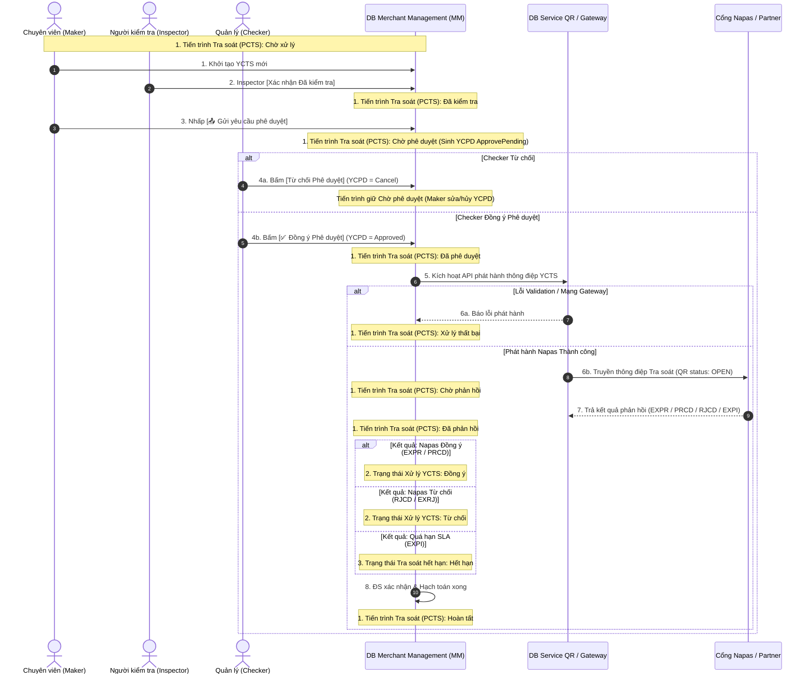
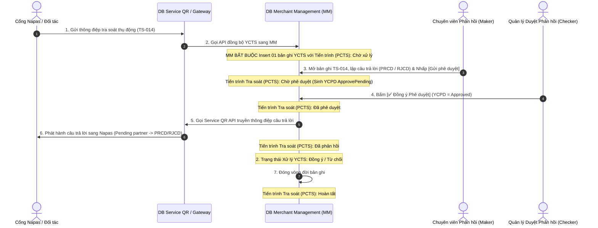

# SƠ ĐỒ LUỒNG THỜI GIAN VÀ TIẾN TRÌNH XỬ LÝ TRA SOÁT (DISPUTE WORKFLOWS V2.1)

---

> **Mã tài liệu:** `EPAY-QT.CG.02_BM33_FLOWS`  
> **Dự án:** Hệ thống Quản lý Tra soát Epay - Petrolimex 2.0  
> **Phiên bản:** `v2.1` (Sơ đồ Tiến trình & 3 Nhóm Trạng thái Tra soát - Luồng CÓ kỹ thuật kiểm tra)  

---

## 1. SƠ ĐỒ LUỒNG TIẾN TRÌNH CHIỀU KHỞI TẠO TRA SOÁT (TCYCTS — CÓ KỸ THUẬT KIỂM TRA)

---

## 2. SƠ ĐỒ LUỒNG TIẾN TRÌNH CHIỀU PHẢN HỒI TRA SOÁT (TCTLTS — TRA SOÁT ĐÃ NHẬN / MÃ TS-014)

---

### 2.1. DIỄN GIẢI CHI TIẾT TỪNG BƯỚC TIẾN TRÌNH LUỒNG TLTS (TRA SOÁT ĐÃ NHẬN / TCTLTS)

1. **Bước 1: Tiếp nhận điện tra soát thụ động (TS-014)**
   - Cổng Napas / Đối tác phát hành thông điệp yêu cầu tra soát thụ động sang Cổng Service QR Gateway của Epay.
   - Cổng Service QR thực hiện kiểm tra định dạng API. Nếu hợp lệ, lưu bản ghi ở trạng thái Gateway `OPEN`.

2. **Bước 2: Kích hoạt API đồng bộ sang hệ thống MM**
   - Cổng Service QR gọi API nội bộ kích hoạt đồng bộ thông tin bản ghi sang DB Merchant Management (MM).
   - **Quy tắc bắt buộc (BR-GENERAL-03):** Hệ thống DB MM bắt buộc phải tự động khởi tạo 01 bản ghi YCTS mới với **Trạng thái Tiến trình = `Chờ xử lý`**, **Trạng thái Xử lý YCTS = `—`**, và **Trạng thái Hết hạn = `Chưa hết hạn`**.

3. **Bước 3: Lập câu trả lời & Trình phê duyệt YCPD**
   - Chuyên viên Đối soát (Maker) truy cập Màn hình Danh sách Tra soát đã nhận (Tab *Chờ xử lý*), mở bản ghi TS-014 để xem chi tiết thông tin và tệp đính kèm từ Napas.
   - Maker chọn phương án trả lời:
     - **`PRCD` (Đồng ý):** Chấp nhận hoàn tiền / báo có / báo nợ thu hồi sai sót.
     - **`RJCD` (Từ chối):** Từ chối yêu cầu tra soát kèm lý do chi tiết.
   - Maker đính kèm tệp minh chứng (nếu có) và nhấp **[📤 Gửi yêu cầu phê duyệt]**.
   - **Cập nhật DB:** Tiến trình YCTS chuyển sang **`Chờ phê duyệt`**, hệ thống tự động **sinh 01 bản ghi YCPD mới** ở trạng thái `ApprovePending` cho Lãnh đạo.

4. **Bước 4: Phê duyệt câu trả lời YCPD (Lãnh đạo / Checker)**
   - Lãnh đạo (Checker) vào xem bản ghi YCPD ở mốc *Chờ phê duyệt*.
   - **Kịch bản 4a (Checker Từ chối):** Bấm **[❌ Từ chối Phê duyệt]**. Bản ghi YCPD chuyển status `Cancel`. YCTS giữ nguyên hoặc chuyển về **`Chờ xử lý`** để Maker điều chỉnh câu trả lời.
   - **Kịch bản 4b (Checker Đồng ý):** Bấm **[✅ Đồng ý Phê duyệt]**. Bản ghi YCPD chuyển status `Approved`. Tiến trình YCTS chuyển sang **`Đã phê duyệt`**, đồng thời hệ thống tự động kích hoạt API phát hành câu trả lời sang Cổng Service QR.

5. **Bước 5 & 6: Phát hành câu trả lời sang Napas**
   - Service QR Gateway tiếp nhận lệnh phát hành câu trả lời từ MM:
     - **Lỗi Validation / Lỗi Mạng:** Chuyển Tiến trình YCTS sang **`Xử lý thất bại`**.
     - **Phát hành Thành công:** Service QR truyền thông điệp câu trả lời (`PRCD` / `RJCD`) sang Napas. Tiến trình YCTS chuyển sang **`Chờ phản hồi`**.

6. **Bước 7: Nhận phản hồi IPN & Hoàn tất hạch toán đối soát**
   - Cổng Napas gửi thông điệp callback / IPN xác nhận kết quả:
     - Napas xác nhận Đồng ý ➔ Tiến trình YCTS = **`Đã phản hồi`**, Trạng thái Xử lý YCTS tại Epay = **`PRCD`**.
     - Napas xác nhận Từ chối ➔ Tiến trình YCTS = **`Đã phản hồi`**, Trạng thái Xử lý YCTS tại Epay = **`RJCD`**.
     - Quá SLA Napas (72h) ➔ Trạng thái Hết hạn = 🟠 **`Đã hết hạn`** (`EXPI`).
   - Kế toán / Đối soát kiểm tra hạch toán tài chính (**Khối Báo nợ 6 trường** khi thu hồi sai sót hoặc **Khối Báo có 6 trường**) và nhấp **[Hoàn tất tra soát]**.
   - Tiến trình YCTS chuyển sang **`Hoàn tất`** (Completed) - Hồ sơ bị khóa read-only 100%.

