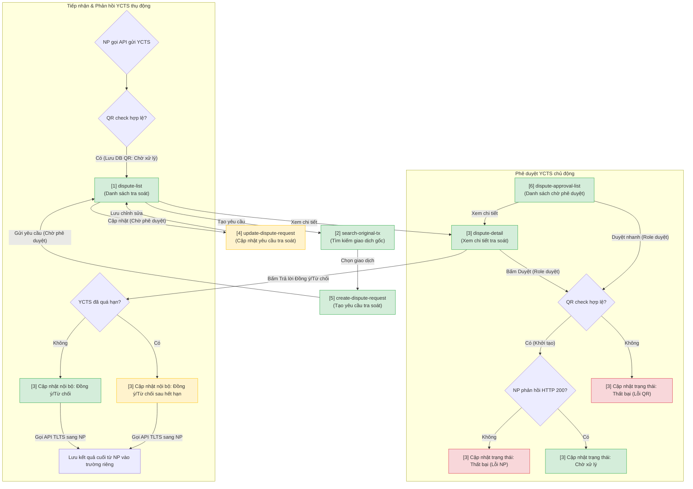

# Quản lý tra soát — User Flow

> Nguồn chia flow duy nhất cho feature này. `/wireframe-ascii` và `/wireframe-html` đọc file này để biết flow nào gồm những màn nào — KHÔNG tự chia flow riêng.

## 1. User Flow (tổng)

> Phủ happy / error / edge cases. `[n]` = số màn hình đối chiếu Mục 2.

## 2. Danh sách màn hình

> Cột `Slug` = định danh máy-đọc DUY NHẤT của màn (khớp `## Screen: {slug}` bên wireframe). `[#]` chỉ để đối chiếu Mục 1.

| [#] | Slug | Màn hình | Mục đích | Thuộc flow |
|-----|------|----------|----------|------------|
| 1 | dispute-list | Danh sách tra soát | Màn hình chính quản lý, tìm kiếm và phân loại yêu cầu tra soát theo các tab trạng thái. | create-dispute-flow / approve-dispute-flow / reply-dispute-flow |
| 1B | dispute-list-all | Danh sách tra soát (Tab Tất cả) | Màn hình hiển thị toàn bộ yêu cầu tra soát không phân biệt trạng thái. | create-dispute-flow / approve-dispute-flow / reply-dispute-flow |
| 2 | search-original-tx | Popup Chọn giao dịch gốc | Popup tìm kiếm và chọn giao dịch gốc trực tiếp từ màn hình tạo yêu cầu tra soát (5). | create-dispute-flow |
| 3 | dispute-detail | Xem chi tiết tra soát | Hiển thị thông tin chi tiết yêu cầu tra soát, file đính kèm, lịch sử thay đổi (log) và các nút hành động (Duyệt/Từ chối hoặc Trả lời). | approve-dispute-flow / reply-dispute-flow |
| 4 | update-dispute-request | Cập nhật yêu cầu tra soát | Cho phép chỉnh sửa thông tin hoặc tải lại file đính kèm khi yêu cầu ở trạng thái Chờ phê duyệt. | create-dispute-flow |
| 5 | create-dispute-request | Tạo yêu cầu tra soát | Nhập loại tra soát, lý do, số tiền, nội dung mô tả và tải lên tệp đính kèm. | create-dispute-flow |
| 6 | dispute-approval-list | Danh sách chờ phê duyệt | Màn hình quản lý phê duyệt tập trung dành riêng cho nhóm người dùng cấp cao có quyền phê duyệt. | approve-dispute-flow |

## 3. Danh sách flow

| Flow-slug | Tên flow | Màn hình gồm | Cases phủ |
|-----------|----------|--------------|-----------|
| **create-dispute-flow** | Tạo yêu cầu tra soát | dispute-list [1] ➔ create-dispute-request [5] (mở popup search-original-tx [2]) ➔ dispute-list [1] | Happy case (tạo YCTS thành công), Edge case (cập nhật YCTS [4] khi ở trạng thái Chờ phê duyệt), Error case (tải file đính kèm lỗi/vượt dung lượng). |
| **approve-dispute-flow** | Phê duyệt tra soát | dispute-list [1] / dispute-approval-list [6] ➔ dispute-detail [3] ➔ dispute-list [1] | Happy case (phê duyệt thành công ➔ Chờ xử lý), Error case (QR check lỗi, NP connection error ➔ Thất bại). |
| **reply-dispute-flow** | Trả lời tra soát | dispute-list [1] ➔ dispute-detail [3] ➔ dispute-list [1] | Happy case (trả lời Đồng ý/Từ chối thành công), Edge case (trả lời Đồng ý/Từ chối sau hết hạn khi đã bị quá hạn). |

## 3.5. Chuyển màn (transitions)

> Nguồn DUY NHẤT cho chuyển màn màn→màn (edge NAVIGATES_TO). `/wireframe-html` đọc bảng này để nối nút/điều hướng — KHÔNG tự suy lại từ prose.

| Từ màn [#] | Đến màn [#] | Trigger | Điều kiện |
|-----------|------------|---------|-----------|
| dispute-list [1] | create-dispute-request [5] | Click "+ Tạo yêu cầu tra soát" | Luôn khả dụng |
| create-dispute-request [5] | search-original-tx [2] (Popup) | Click "Chọn giao dịch gốc" | Đang thao tác trong form |
| search-original-tx [2] (Popup) | create-dispute-request [5] | Click "Chọn & Xác nhận" | Đã tích chọn 1 giao dịch gốc |
| create-dispute-request [5] | dispute-list [1] | Click "Gửi phê duyệt" | Submit form hợp lệ ➔ trạng thái Chờ phê duyệt |
| dispute-list [1] | update-dispute-request [4] | Click "Cập nhật" | Chỉ hiển thị với các bản ghi ở trạng thái Chờ phê duyệt |
| update-dispute-request [4] | dispute-list [1] | Click "Lưu" / "Hủy" | Lưu chỉnh sửa thành công hoặc hủy thao tác |
| dispute-list [1] | dispute-detail [3] | Click "Xem chi tiết" | Luôn khả dụng |
| dispute-list-all [1B] | dispute-detail [3] | Click "Xem chi tiết" | Luôn khả dụng |
| dispute-approval-list [6] | dispute-detail [3] | Click "Xem chi tiết" | Luôn khả dụng |
| dispute-detail [3] | dispute-detail [3] (Refreshed) | Click "Duyệt" / "Từ chối" | Phê duyệt hoàn tất ➔ cập nhật trạng thái mới |
| dispute-detail [3] | dispute-detail [3] (Refreshed) | Click "Trả lời Đồng ý/Từ chối" | Trả lời hoàn tất ➔ cập nhật trạng thái mới |

## 4. Open Questions

*(Không có câu hỏi nào chưa giải quyết. Toàn bộ các OQ đã được chốt ở bước brainstorm).*
