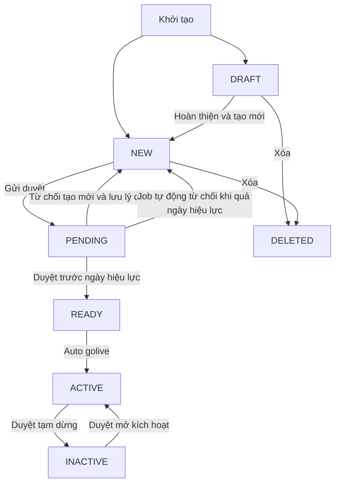

# TÀI LIỆU PHÂN TÍCH YÊU CẦU HỆ THỐNG

## Nghiệp vụ quản lý cấu hình phí trả đối tác CTT

| Thông tin | Nội dung |
|---|---|
| Dự án | EPAY Portal 2.0 |
| Phân hệ | Phí trả đối tác CTT |
| Mã tài liệu | EPAY-SRS-PARTNER-FEE-CTT |
| Phiên bản | V0.6 |
| Phạm vi lưu hành | Nội bộ |
| Ngày cập nhật | 11/11/2026 |
| Mẫu cấu trúc | EPAY_CTT_SRS_MM04_CauHinhPhiTraDoiTac_V0.1_29102026.docx |

## BẢNG GHI NHẬN THAY ĐỔI TÀI LIỆU

| Ngày thay đổi | Mục thay đổi | Mô tả thay đổi | A M D | Người thực hiện | Phiên bản |
|---|---|---|---|---|---|
| 11/11/2026 | Trạng thái và job | Bỏ duyệt tạo mới PENDING sang ACTIVE; bổ sung job từ chối YCPD quá ngày hiệu lực bởi Hệ thống. | M | Người dùng xác nhận trong chat | V0.6 |
| 11/11/2026 | Toàn bộ cấu trúc | Sắp xếp theo mẫu Word; giữ riêng bộ use case CTT; đồng nhất mã UC theo danh mục; giữ trạng thái NEW sau từ chối duyệt tạo mới. | M | Chưa ghi nhận người xác nhận | V0.5 |

A: Thêm; M: Sửa; D: Xóa. Lịch sử trước V0.5 tham chiếu lịch sử phiên bản của kho tài liệu.

## TRANG KÝ

| Vai trò | Họ tên | Chức danh | Ngày ký | Xác nhận |
|---|---|---|---|---|
| Người lập | Chưa xác nhận | Chưa xác nhận | Chưa ký | Chưa ký |
| Người kiểm tra | Chưa xác nhận | Chưa xác nhận | Chưa ký | Chưa ký |
| Người phê duyệt | Chưa xác nhận | Chưa xác nhận | Chưa ký | Chưa ký |

## MỤC LỤC

- [1 Giới thiệu chung](#1-giới-thiệu-chung)
- [2 Tổng quan mô hình](#2-tổng-quan-mô-hình)
- [2.1 Tổng quan](#21-tổng-quan)
- [2.2 CTT-UC01 Tìm kiếm và xem danh sách cấu hình phí](#uc-01)
- [2.3 CTT-UC02 Xuất tệp dữ liệu cấu hình phí](#uc-02)
- [2.4 CTT-UC03 Xem chi tiết cấu hình phí và lịch sử hoạt động](#uc-03)
- [2.5 CTT-UC04 Xóa cấu hình phí](#uc-04)
- [2.6 CTT-UC05 Xử lý thông tin hồ sơ cấu hình phí](#uc-05)
- [2.7 CTT-UC06 Tự động kích hoạt cấu hình phí](#uc-06)
- [2.8 CTT-UC07 Tự động từ chối YCPD quá ngày hiệu lực](#uc-07)
- [3 Các điểm cần đối chiếu](#3-các-điểm-cần-đối-chiếu)

# 1 GIỚI THIỆU CHUNG

## 1.1 Mục đích tài liệu

Đặc tả yêu cầu quản lý cấu hình phí trả đối tác thuộc CTT để BA, phát triển, kiểm thử và vận hành cùng sử dụng. Tài liệu trình bày phạm vi, trạng thái, phân quyền, luồng xử lý, giao diện, quy tắc và trường hợp lỗi theo bố cục mẫu Word.

## 1.2 Phạm vi hệ thống

Phạm vi dữ liệu, phân quyền và tác vụ trong tài liệu này chỉ áp dụng cho **CTT**. CTT và QRGW có bộ use case độc lập; không truy vấn, xuất tệp hoặc phê duyệt chéo dữ liệu giữa hai phân hệ.

Theo đặc tả giao diện V2 hiện có, hai loại phí áp dụng là **Phí xử lý giao dịch** và **Phí thanh toán**; ba hình thức thu phí là **1 bậc**, **Theo SLGD**, **Theo GTGD**. Phân hệ được xác định từ menu; không hiển thị trường/cột Nguồn dữ liệu.

Mẫu Word được sử dụng cho **cấu trúc tài liệu**. Các nội dung duyệt hai cấp, phí duy trì, phí DVGT và đồng bộ phí sang Ví trong mẫu không tự động trở thành yêu cầu mới của phiên bản này.

## 1.3 Định nghĩa thuật ngữ và các từ viết tắt

| Từ viết tắt | Giải thích |
|---|---|
| EPAY | Hệ thống Cổng thanh toán EPAY |
| CTT | Cổng thanh toán |
| QRGW | QR Gateway |
| CHP | Cấu hình phí |
| YCPD | Yêu cầu phê duyệt |
| Maker | Người tạo, sửa và gửi yêu cầu |
| Checker | Người thẩm định và phê duyệt độc lập với Maker |
| SLGD | Số lượng giao dịch |
| GTGD | Giá trị giao dịch |
| MCC | Mã ngành nghề kinh doanh |
| MID | Mã định danh đơn vị chấp nhận thanh toán tại đối tác |

## 1.4 Tài liệu liên quan

| STT | Tên tài liệu | Mã tài liệu hoặc nguồn |
|---|---|---|
| 1 | Mẫu SRS Word | `EPAY_CTT_SRS_MM04_CauHinhPhiTraDoiTac_V0.1_29102026.docx`, bản người dùng cung cấp ngày 11/11/2026 |
| 2 | SRS chức năng chung | [partner-fee-management-spec.md](partner-fee-management-spec.md) |
| 3 | Quy tắc nghiệp vụ vòng đời | [2.6.5-yeu-cau-nghiep-vu-chung.md](2.6.5-yeu-cau-nghiep-vu-chung.md) |
| 4 | Đặc tả giao diện V2 | [partner-fee-management-screens.md](partner-fee-management-screens.md) |
| 5 | Sơ đồ luồng và trạng thái | [Flows](partner-fee-management-flows.md), [States](partner-fee-management-states.md) |
| 6 | Mô hình dữ liệu | [ERD](partner-fee-management-erd.md) |
| 7 | Danh mục use case tách theo phân hệ | [Use case index](../usecases/usecase-index.md) |
| 8 | Quyết định nghiệp vụ | Người dùng xác nhận trong chat: trạng thái CHP sau từ chối duyệt tạo mới là NEW; trạng thái YCPD là Rejected. |

# 2 TỔNG QUAN MÔ HÌNH

## 2.1 Tổng quan

### 2.1.1 Danh sách chức năng

| Mã | Use Case | Actor chính |
|---|---|---|
| CTT-UC01 | Tìm kiếm và xem danh sách cấu hình phí | Maker và Checker |
| CTT-UC02 | Xuất tệp dữ liệu cấu hình phí | Maker và Checker |
| CTT-UC03 | Xem chi tiết cấu hình phí và lịch sử hoạt động | Maker và Checker |
| CTT-UC04 | Xóa cấu hình phí | Maker |
| CTT-UC05 | Xử lý thông tin hồ sơ cấu hình phí | Maker và Checker |
| CTT-UC06 | Tự động kích hoạt cấu hình phí | Hệ thống |
| CTT-UC07 | Tự động từ chối YCPD quá ngày hiệu lực | Hệ thống |

Thêm mới, lưu nháp, cập nhật và tính thử phí được mô tả trong UC05. UC04 dùng cho Xóa; UC06 dùng cho Auto-golive, thống nhất với danh mục use case hiện có.

### 2.1.2 Luồng trạng thái CHP trả đối tác

#### 2.1.2.1 Danh sách trạng thái

| Trạng thái | Mô tả | Kiểu hiển thị |
|---|---|---|
| DRAFT | Bản nháp chưa hoàn tất | Badge Bản nháp |
| NEW | Đã tạo hoặc quay về sau từ chối duyệt tạo mới | Badge Mới; lý do từ chối hiển thị tại YCPD liên kết |
| PENDING | Hồ sơ đang chờ phê duyệt | Badge Chờ phê duyệt |
| READY | Đã duyệt và chờ ngày có hiệu lực | Badge Chờ hiệu lực |
| ACTIVE | Đang có hiệu lực | Badge Đang hoạt động |
| INACTIVE | Tạm dừng hoặc hết hiệu lực | Badge Ngừng hoạt động |
| DELETED | Đã xóa logic | Không hiển thị trong danh sách vận hành |

`Rejected` là kết quả YCPD, không phải trạng thái CHP. Khi từ chối cập nhật/tạm dừng/mở kích hoạt, bản ghi gốc giữ ACTIVE hoặc INACTIVE theo ma trận nghiệp vụ; không chuyển bản ghi đang vận hành về NEW.

#### 2.1.2.2 Luồng trạng thái tổng quan



Sơ đồ trên là tổng quan. Quy tắc cho cập nhật, rút yêu cầu, đổi người duyệt và từng loại YCPD thực hiện theo UC05 và bảng vòng đời liên kết.

### 2.1.3 Quy tắc tính phí

| Nội dung | Quy tắc và nguồn |
|---|---|
| Phí xử lý giao dịch | Áp dụng chung hoặc tách riêng theo loại giao dịch Thanh toán và Hoàn trả. Chi tiết form và mức phí tại UC05. |
| Phí thanh toán | Hỗ trợ mức phí, tỷ lệ, mức tối thiểu/tối đa theo cấu hình và hình thức 1 bậc, SLGD, GTGD. |
| Trần và sàn | Nếu cùng khai báo thì phải thỏa mãn 0 ≤ Min ≤ Max; tham chiếu BR-003 trong SRS chung. |
| Công cụ tính thử | Theo BR-004 trong SRS chung: tính phí tỷ lệ theo GTGD, áp trần/sàn, tính VAT và làm tròn. Không tự thay công thức bằng ví dụ của mẫu Word. |
| Phạm vi biểu phí | Chỉ chọn biểu phí của đúng phân hệ và đúng điều kiện áp dụng. |

### 2.1.4 Job và tiến trình tự động

Có hai job riêng: Auto-golive tại UC06 và tự động từ chối YCPD quá ngày hiệu lực tại UC07. Job tính phí giao dịch trong mẫu Word là nội dung khác với Auto-golive; bố cục mẫu không được dùng để suy diễn hoặc bổ sung một job tính phí mới vào phạm vi hiện có.

### 2.1.5 Danh sách mối quan hệ trạng thái và hành động không được phép thao tác

| Trạng thái hiện tại | Hành động không được phép | Ràng buộc |
|---|---|---|
| DRAFT | Duyệt có hiệu lực trực tiếp | Hoàn thiện thành NEW rồi gửi duyệt |
| PENDING | Xóa bản ghi | Phải hoàn tất hoặc rút YCPD theo quyền |
| READY | Xóa trực tiếp | Thực hiện đúng luồng cập nhật tại bảng vòng đời |
| ACTIVE | Xóa; áp dụng thay đổi chưa duyệt | Bảo toàn bản gốc phục vụ tính cước trong khi chờ duyệt |
| INACTIVE | Xóa bản ghi đã có hiệu lực | Bảo toàn lịch sử đối soát |
| DELETED | Khôi phục bằng thao tác nghiệp vụ | Kết thúc vòng đời vận hành |

### 2.1.6 Danh sách mối quan hệ vai trò và chức năng

| Chức năng | Maker | Checker | Hệ thống |
|---|---|---|---|
| Tra cứu, xuất tệp, xem chi tiết | Theo quyền | Theo quyền | Cung cấp dữ liệu |
| Lưu nháp, thêm mới, cập nhật, xóa | Theo trạng thái và quyền | Không sửa trực tiếp | Kiểm tra tính hợp lệ và ghi lịch sử |
| Gửi, rút, đổi người duyệt | Theo điều kiện YCPD | Không tự tạo thay Maker | Quản lý YCPD |
| Phê duyệt, từ chối | Không tự duyệt yêu cầu của mình | Theo phân công và quyền | Lưu kết quả, lý do và lịch sử |
| Auto-golive | Không thực hiện thủ công trong UC06 | Không thực hiện thủ công trong UC06 | Tự động thực hiện |

### 2.1.7 Danh sách các loại yêu cầu phê duyệt

| Trạng thái hiện tại | Ý nghĩa | Hành động thao tác | Loại yêu cầu phê duyệt được tạo ra |
|---|---|---|---|
| NEW | Hồ sơ mới | Gửi phê duyệt | Duyệt mở tạo hồ sơ CHP Trả đối tác |
| ACTIVE | Sửa biểu phí | Gửi duyệt cập nhật | Duyệt cập nhật hồ sơ CHP Trả đối tác |
| ACTIVE | Ngừng áp dụng | Gửi duyệt tạm dừng | Duyệt tạm dừng hồ sơ CHP Trả đối tác |
| INACTIVE | Áp dụng trở lại | Gửi duyệt mở kích hoạt | Duyệt mở kích hoạt CHP Trả đối tác |

Mỗi yêu cầu thuộc đúng phân hệ của cấu hình phí. Tên và cách lưu từng YCPD được mô tả tại UC05.

<a id="uc-01"></a>

## 2.2 CTT-UC01: Tìm kiếm và xem danh sách cấu hình phí đối tác CTT

### 2.2.1 Use case

| Mục | Nội dung đặc tả chi tiết |
|---|---|
| **Use Case** | **Tra cứu và xem danh sách cấu hình phí đối tác Cổng Thanh Toán (CTT)** |
| **ID** | **CTT - UC01** |
| **Description** | Tra cứu danh sách các biểu phí trả cho ngân hàng và tổ chức thẻ kết nối qua Cổng thanh toán (CTT) theo bộ lọc tiêu chí, chuyển đổi giữa các tab trạng thái và phân trang kết quả. |
| **Actor** | Maker CTT, Checker CTT, Cán bộ Đối soát, Kế toán chi phí, Hệ thống Merchant Management |
| **Trigger** | Người dùng click menu điều hướng: **`Quản lý cấu hình phí` > `Phí đối tác CTT`** trên thanh Navigation bên trái; hoặc click nút [Tìm kiếm]. |
| **Pre-Condition** | - Tài khoản người dùng đã được tạo và kích hoạt.<br>- Người dùng đã đăng nhập vào hệ thống EPAY Portal.<br>- Người dùng có quyền truy cập chức năng xem danh sách và tra cứu cấu hình phí CTT.<br>- Dữ liệu biểu phí CTT đã được ghi nhận trong cơ sở dữ liệu. |
| **Post-Condition** | Hệ thống hiển thị danh sách các mã phí CTT thỏa mãn đúng tiêu chí tìm kiếm và tab trạng thái kích hoạt. |
| **Basic flow** | 1. Người dùng vào menu **[Quản lý cấu hình phí] > [Phí trả đối tác] > [Phí đối tác CTT]** ở thanh menu bên trái.<br>2. Hệ thống hiển thị màn hình danh sách cấu hình phí CTT.<br>3. Người dùng chọn **[Tìm kiếm]** để mở bộ lọc.<br>4. Hệ thống hiển thị các tiêu chí tra cứu cấu hình phí CTT. |
| **Alternative flow** | - **A1**: User không nhập tiêu chí lọc $\rightarrow$ Hệ thống hiển thị tất cả cấu hình phí CTT theo giá trị lọc mặc định.<br>- **A2**: Người dùng chọn **[Xóa]** $\rightarrow$ Hệ thống xóa các điều kiện lọc, trả giao diện về trạng thái ban đầu với tất cả cấu hình phí CTT theo giá trị lọc ban đầu.<br>- **A3**: Người dùng chọn **[Xuất tệp]** $\rightarrow$ Hệ thống xuất danh sách tổng hợp theo các trường tin tương ứng tại bảng danh sách (định dạng file: PDF, Excel) *(Chi tiết xem CTT-UC02)*.<br>- **A4**: User chọn tiêu chí lọc $\rightarrow$ Hệ thống hiển thị bảng rỗng kèm thông báo không tìm thấy kết quả phù hợp. |
| **Exception flow** | - **E1**: Lỗi kết nối với cơ sở dữ liệu hoặc API Timeout $> 10$s.<br>- **E2**: Người dùng không có quyền truy cập chức năng CTT.<br>- **E3**: Lỗi kết nối mạng internet.<br>- **E4**: Người dùng chọn thời gian áp dụng Từ ngày lớn hơn Đến ngày. |
| **Business Rules** | [Yêu cầu nghiệp vụ chung tra cứu cấu hình phí CTT](#223-yêu-cầu-nghiệp-vụ-chung) |
| **Non-functional requirement** | Màn hình hiển thị kết quả tra cứu trong vòng không quá 03 giây. |

---

### 2.2.2 Giao diện

#### Màn hình Wireframe liên kết:
* **CTT-UC01-WF01.1**: Danh sách CTT — Tab Tất cả (Figma Frame ID: `4082:10325`)
* **CTT-UC01-WF01.2**: Danh sách CTT — Tab Đang hoạt động (Figma Frame ID: `4087:10703`)
* **CTT-UC01-WF01.3**: Danh sách CTT — Tab Chờ phê duyệt (Figma Frame ID: `4088:10992`)

#### Bảng Đặc tả Từ điển Trường Dữ liệu (Screen Data Dictionary):

| Component Name | Data Type | Validation rules (M/O/C) | Editable (Y/N) | Other Validation | Action rules |
|---|---|:---:|:---:|---|---|
| **Tiêu đề phân hệ** | Label | M | N | - | Hiển thị: *“Quản lý cấu hình phí trả đối tác — Cổng Thanh Toán (CTT)”*. |
| **Thời gian hiệu lực** | Date time | C | Y | Date time | Lựa chọn từ ngày đến ngày (tối đa 365 ngày). Mặc định: Ngày đầu tháng hiện tại đến ngày hiện tại. |
| **Loại phí** | Dropdown list | O | Y | Multiple selection | Mặc định = *“Tất cả”*. Các giá trị: Phí xử lý giao dịch, Phí thanh toán. |
| **Trạng thái** | Dropdown list | O | Y | Multiple selection | Mặc định = *“NEW, ACTIVE, INACTIVE”*. Các giá trị: New, Active, Inactive, Draft. |
| **Phương thức thanh toán** | Dropdown list | O | Y | Multiple selection | Mặc định = *“Tất cả”*. Danh mục CTT: Thẻ quốc tế (Visa, Master, JCB), Thẻ nội địa ATM, Chuyển khoản ngân hàng. |
| **Kỳ trả phí** | Dropdown list | O | Y | Multiple selection | Mặc định = *“Tất cả”*. Các giá trị: Ngày, Tháng, Năm, Quý. |
| **Tiến trình phê duyệt** | Dropdown list | O | Y | Multiple selection | - Giá trị mặc định = “Tất cả”.<br>- Danh sách hiển thị theo thứ tự ABC.<br>- Tiến trình phê duyệt bao gồm các giá trị tham chiếu tại [Danh sách các loại yêu cầu phê duyệt](#217-danh-sách-các-loại-yêu-cầu-phê-duyệt). |
| **Quicksearch** | Search bar | O | Y | Text $\le 100$ chars | Tìm nhanh theo Mã cấu hình, Tên cấu hình hoặc Mô tả. Nhấn Enter để tìm. |
| **Nút [Xóa]** | Button | O | Y | Click | Clear các điều kiện tìm kiếm về giá trị mặc định. |
| **Nút [Tìm kiếm]** | Button | O | Y | Click | Thực hiện truy vấn danh sách CHP CTT theo điều kiện lọc. |
| **Nút [Xuất tệp]** | Button | O | Y | Click | Mở menu lựa chọn định dạng file xuất (Excel/PDF). |
| **Nút [Tùy chỉnh]** | Button | O | Y | Click | Mở danh sách chọn trường tin hiển thị trên Gridview theo mục 2.2.5. |
| **Chi tiết cột dữ liệu** | Grid Table | M | N | Readonly / Link | Tham chiếu mục [2.2.5 Danh sách trường tin tùy chỉnh](#225-danh-sách-trường-tin-tùy-chỉnh). Mã phí là hyperlink mở màn hình Chi tiết. |

---

### 2.2.3 Yêu cầu nghiệp vụ chung

#### Chi tiết xử lý nghiệp vụ

1. Click **[Quản lý cấu hình phí]** >> click **[Phí đối tác CTT]** ở thanh Navigation bên trái. Hệ thống hiển thị Danh sách cấu hình phí CTT tương ứng.
2. Chọn nút **[Tìm kiếm]** ở góc trên bên phải $\rightarrow$ Màn hình show ra các trường điều kiện lọc dữ liệu dành riêng cho CTT, cho phép user lựa chọn giá trị để tra cứu.
3. Lựa chọn giá trị tại các trường thông tin: Đối tác/Ngân hàng (Vietcombank, BIDV, MBBank...), Loại phí CTT (Xử lý GD, Thanh toán), PTTT (Thẻ quốc tế Visa/Master/JCB, Thẻ nội địa Napas), Kỳ trả phí, Trạng thái.
4. Click nút **[Tìm kiếm]**.
5. Hệ thống kiểm tra tính hợp lệ thông tin, thực hiện truy vấn dữ liệu từ CSDL theo điều kiện lọc.
6. Hệ thống hiển thị danh sách cấu hình phí CTT theo điều kiện lọc ở trên.


| Mã Quy tắc | Tên Quy tắc | Nội dung đặc tả nghiệp vụ chi tiết |
|---|---|---|
| **CTT-UC01-BR01.1** | **Quy tắc hiển thị danh sách CHP CTT** | - Chỉ hiển thị đối với người dùng được cấp quyền truy cập CTT.<br>- Mặc định hiển thị các cấu hình có trạng thái: `NEW`, `ACTIVE`, `INACTIVE`.<br>- Phân trang mặc định là **20 dòng/trang**, tùy chọn: `5 / 10 / 20 / 30 / 50 / 100 / 200 / 500`. |
| **CTT-UC01-BR01.2** | **Quy tắc điều hướng theo Tab trạng thái** | - Tab Tất cả: Hiển thị toàn bộ bản ghi CTT.<br>- Tab Đang hoạt động: Lọc bản ghi CTT có `status = ACTIVE`.<br>- Tab Chờ phê duyệt: Lọc bản ghi CTT có `status = PENDING`. |
| **CTT-UC01-BR01.3** | **Ràng buộc khoảng thời gian tra cứu** | Khoảng cách giữa Từ ngày và Đến ngày không vượt quá 365 ngày. Từ ngày phải nhỏ hơn hoặc bằng Đến ngày. |

---

### 2.2.4 Bảng mã lỗi

| No | Trường hợp lỗi | Mã lỗi đặc tả | Message | Xử lý và hiển thị |
|---|---|---|---|---|
| 1 | Lỗi kết nối CSDL<br>Điều kiện: Mất kết nối CSDL khi gửi truy vấn lọc danh sách | **E1** | *“Lỗi kết nối cơ sở dữ liệu. Vui lòng thử lại sau hoặc liên hệ Quản trị viên!”* | Mức độ: Critical. Xử lý theo thông báo và nhánh ngoại lệ của use case. |
| 2 | Không có quyền truy cập<br>Điều kiện: Người dùng không thuộc nhóm quyền tra cứu cấu hình phí CTT | **E2** | *“Bạn không có quyền truy cập chức năng này. Vui lòng liên hệ Quản trị viên để được cấp quyền!”* | Mức độ: Major. Xử lý theo thông báo và nhánh ngoại lệ của use case. |
| 3 | Lỗi kết nối internet<br>Điều kiện: Mất kết nối mạng hoặc API Timeout $> 10$s | **E3** | *“Lỗi kết nối mạng internet. Vui lòng kiểm tra đường truyền và thử lại!”* | Mức độ: Major. Xử lý theo thông báo và nhánh ngoại lệ của use case. |
| 4 | Ngày áp dụng không hợp lệ<br>Điều kiện: Maker chọn Từ ngày lớn hơn Đến ngày, hoặc khoảng cách $> 365$ ngày | **E-004** | *“Thời gian áp dụng từ ngày phải nhỏ hơn hoặc bằng đến ngày và khoảng cách không quá 365 ngày.”* | Mức độ: Major. Xử lý theo thông báo và nhánh ngoại lệ của use case. |
| 5 | Không tìm thấy kết quả<br>Điều kiện: Không có bản ghi nào trong hệ thống thỏa mãn điều kiện lọc | **E-010** | *“Không tìm thấy kết quả phù hợp với điều kiện tìm kiếm. Vui lòng thử lại với tiêu chí khác!”* | Mức độ: Info. Xử lý theo thông báo và nhánh ngoại lệ của use case. |

---

### 2.2.5 Danh sách trường tin tùy chỉnh

| STT | Tên trường tin | Lựa chọn mặc định | Giá trị dữ liệu |
|:---:|---|:---:|---|
| **1** | **STT** | **Y** | Sắp xếp theo thứ tự kết quả trả về. |
| **2** | **Mã cấu hình** | **Y** | Mã định danh biểu phí CTT (vd: `CTT_FE_VCB_001`). |
| **3** | **Tên cấu hình** | **Y** | Tên cấu hình phí CTT tương ứng. |
| **4** | **Loại phí** | **Y** | Loại phí của CHP CTT. |
| **5** | **Trạng thái** | **Y** | Trạng thái của CHP CTT (`Active`, `Pending`, `Inactive`, `New`, `Draft`). |
| **6** | **Kỳ trả phí** | **Y** | Kỳ trả phí của CHP CTT. |
| **7** | **Thời gian hiệu lực** | **Y** | Thời điểm bắt đầu có hiệu lực tính cước. |
| **8** | **Thời gian khởi tạo** | **Y** | Thời điểm tạo bản ghi cấu hình phí CTT. |
| **9** | **Yêu cầu phê duyệt** | **N** | Phân loại yêu cầu phê duyệt thông tin phí CTT. |
| **10** | **Trạng thái phê duyệt** | **N** | Trạng thái phê duyệt tương ứng với YCPD. |
| **11** | **Mã yêu cầu** | **N** | Mã yêu cầu phê duyệt liên kết. |
| **12** | **Ghi chú** | **N** | Thông tin mô tả chi tiết cấu hình. |
| **13** | **Đồng tiền giao dịch** | **N** | Loại tiền tệ sử dụng khi giao dịch (VND, USD...). |

---

<a id="uc-02"></a>

## 2.3 CTT-UC02: Xuất tệp dữ liệu CHP Trả đối tác CTT

### 2.3.1 Use case

| Mục | Nội dung đặc tả chi tiết |
|---|---|
| **Use Case** | **Xuất tệp dữ liệu danh sách cấu hình phí đối tác Cổng Thanh Toán (CTT)** |
| **ID** | **CTT - UC02** |
| **Description** | Cho phép người dùng xuất dữ liệu danh sách biểu phí CTT ra tệp định dạng Excel hoặc PDF phục vụ công tác đối soát cước thanh toán quốc tế và nội địa, lưu trữ hồ sơ và báo cáo tài chính. |
| **Actor** | Maker CTT, Checker CTT, Đối soát viên, Kế toán viên |
| **Trigger** | Người dùng click chọn button **[Xuất tệp ▼]** trên thanh công cụ phía trên bảng danh sách CTT. |
| **Pre-Condition** | Người dùng đã đăng nhập, có quyền xuất tệp dữ liệu phân hệ CTT và đã có kết quả tìm kiếm/danh sách trên màn hình. |
| **Post-Condition** | Hệ thống sinh tệp tải về thành công (định dạng `.xlsx` hoặc `.pdf`) chứa danh sách cấu hình phí CTT theo đúng điều kiện lọc hiện tại. |
| **Basic flow** | 1. Người dùng vào menu **[Quản lý cấu hình phí] > [Phí trả đối tác] > [Phí đối tác CTT]** ở thanh menu bên trái.<br>2. Hệ thống hiển thị màn hình danh sách cấu hình phí CTT.<br>3. Người dùng chọn **[Xuất tệp]** trên màn hình danh sách.<br>4. Hệ thống hiển thị danh sách định dạng tệp hỗ trợ xuất. |
| **Alternative flow** | - **A1**: Không có bản ghi nào thỏa mãn điều kiện lọc $\rightarrow$ Hệ thống hiển thị cảnh báo: *“Không có dữ liệu để xuất tệp”*, không thực hiện sinh tệp trống.<br>- **A2**: Số lượng bản ghi vượt quá 50.000 dòng $\rightarrow$ Hệ thống hiển thị thông báo yêu cầu người dùng thu hẹp khoảng thời gian hoặc xuất dữ liệu qua hàng đợi tác vụ ngầm. |
| **Exception flow** | - **E1**: Lỗi timeout khi kết xuất tệp (> 30 giây) $\rightarrow$ Thông báo lỗi hệ thống và gợi ý người dùng thử lại.<br>- **E2**: Mất kết nối mạng internet trong lúc tải file. |
| **Business Rules** | [Yêu cầu nghiệp vụ chung xuất tệp dữ liệu CHP CTT](#233-yêu-cầu-nghiệp-vụ-chung) |
| **Non-functional requirement** | Thời gian xuất file $< 5$ giây với tập dữ liệu dưới 5.000 dòng; $< 15$ giây với tập dữ liệu từ 5.000 đến 50.000 dòng. |

---

### 2.3.2 Giao diện

#### Màn hình Wireframe liên kết:
* **CTT-UC02-WF01**: Menu Dropdown Xuất tệp trên thanh công cụ Danh sách CTT (`4082:10325`)

#### Bảng Đặc tả Từ điển Trường Dữ liệu (Screen Data Dictionary):

| Component Name | Data Type | Validation rules (M/O/C) | Editable (Y/N) | Other Validation | Action rules |
|---|---|:---:|:---:|---|---|
| **Button [Xuất tệp ▼]** | Button | O | Y | Click | Hiển thị menu dropdown 2 mục chọn định dạng file xuất. |
| **Option [Xuất Excel (.xlsx)]** | Menu item | O | Y | Click | Kích hoạt tiến trình kết xuất bảng tính Excel với đầy đủ định dạng số, ngày tháng và kẻ bảng chuẩn. |
| **Option [Xuất PDF (.pdf)]** | Menu item | O | Y | Click | Kích hoạt tiến trình xuất báo cáo tài liệu PDF khổ ngang (A4 Landscape) có header/footer và đánh số trang. |
| **Toast thông báo tiến trình** | Toast Banner | C | N | Readonly | Hiển thị thông báo tiến trình xử lý kèm biểu tượng loading. |

---

### 2.3.3 Yêu cầu nghiệp vụ chung

#### Chi tiết xử lý nghiệp vụ

1. Người dùng chọn các tiêu chí lọc CTT và bấm [Tìm kiếm] để nạp danh sách kết quả (hoặc sử dụng danh sách mặc định).
2. Click button **[Xuất tệp ▼]** ở góc trên bên phải bảng danh sách CTT.
3. Hệ thống hiển thị dropdown gồm 2 lựa chọn: *Xuất Excel (.xlsx)* và *Xuất PDF (.pdf)*.
4. Người dùng click chọn định dạng mong muốn.
5. Hệ thống kiểm tra số lượng bản ghi thỏa mãn điều kiện lọc.
6. Hệ thống thực hiện kết xuất dữ liệu và kích hoạt trình tải tệp xuống máy tính của người dùng.


| Mã Quy tắc | Tên Quy tắc | Nội dung đặc tả nghiệp vụ chi tiết |
|---|---|---|
| **CTT-UC02-BR01.1** | **Quy tắc đặt tên tệp kết xuất CTT** | Tên tệp được tự động đặt theo quy chuẩn: `EPAY_CHP_CTT_[TabTrangThai]_[ddMMyyyy_HHmmss].[ext]` (Ví dụ: `EPAY_CHP_CTT_TatCa_08112026_153000.xlsx`). |
| **CTT-UC02-BR01.2** | **Quy tắc dữ liệu trong tệp xuất CTT** | Dữ liệu trong tệp xuất ra phải khớp 100% với danh sách kết quả tìm kiếm theo bộ lọc CTT hiện tại, bao gồm cả các dòng ở các trang sau. Cột Mã cấu hình giữ nguyên định dạng chuỗi văn bản. |
| **CTT-UC02-BR01.3** | **Quy tắc ghi nhận nhật ký xuất tệp** | 100% thao tác xuất tệp phải được ghi nhận vào nhật ký hệ thống (`audit_logs`) gồm: User thực hiện, Thời điểm xuất, Bộ tiêu chí lọc đã áp dụng và Số lượng bản ghi kết xuất. |

---

### 2.3.4 Bảng mã lỗi

| No | Trường hợp lỗi | Mã lỗi đặc tả | Message | Xử lý và hiển thị |
|---|---|---|---|---|
| 1 | Không có dữ liệu để xuất<br>Điều kiện: Danh sách tìm kiếm CTT rỗng không có bản ghi nào | **E1** | *“Không có dữ liệu để xuất tệp. Vui lòng thử lại với điều kiện tìm kiếm khác!”* | Mức độ: Minor. Xử lý theo thông báo và nhánh ngoại lệ của use case. |
| 2 | Vượt quá số lượng bản ghi tối đa<br>Điều kiện: Số lượng bản ghi thỏa mãn điều kiện lọc $> 50.000$ dòng | **E2** | *“Dữ liệu kết xuất vượt quá giới hạn 50.000 bản ghi. Vui lòng thu hẹp khoảng thời gian tìm kiếm hoặc lọc theo đối tác cụ thể!”* | Mức độ: Major. Xử lý theo thông báo và nhánh ngoại lệ của use case. |
| 3 | Lỗi timeout khi tạo tệp<br>Điều kiện: Quá trình sinh tệp kéo dài quá 30 giây | **E3** | *“Hệ thống đang quá tải, không thể tạo tệp vào lúc này. Vui lòng thử lại sau giây lát!”* | Mức độ: Major. Xử lý theo thông báo và nhánh ngoại lệ của use case. |
| 4 | Mất kết nối internet khi tải tệp<br>Điều kiện: Gián đoạn kết nối mạng khi tải luồng dữ liệu tệp | **E4** | *“Đường truyền mạng bị gián đoạn trong khi tải tệp. Vui lòng kiểm tra kết nối mạng và bấm Xuất tệp lại!”* | Mức độ: Major. Xử lý theo thông báo và nhánh ngoại lệ của use case. |

---

<a id="uc-03"></a>

## 2.4 CTT-UC03: Xem chi tiết thông tin phí Trả đối tác CTT

### 2.4.1 Use case

| Mục | Nội dung đặc tả chi tiết |
|---|---|
| **Use Case** | **Xem chi tiết cấu hình phí CTT và Lịch sử thay đổi (Audit Trail)** |
| **ID** | **CTT - UC03** |
| **Description** | Hiển thị chi tiết toàn diện thông tin bản ghi biểu phí CTT gồm Khối Thông tin chung, Khối Yêu cầu phê duyệt (nếu có), Khối Biểu phí theo loại thẻ/kênh kết nối CTT, thanh tác vụ động và tab dòng thời gian lưu vết kiểm toán (Audit Trail Timeline View). |
| **Actor** | Maker CTT, Checker CTT, Quản trị viên, Kiểm toán viên, Cán bộ Đối soát |
| **Trigger** | Người dùng click vào hyperlink **[Mã phí CTT]** trên bảng danh sách, hoặc chọn **[Xem chi tiết]** từ menu thao tác. |
| **Pre-Condition** | Bản ghi cấu hình CTT tồn tại trong CSDL và người dùng có quyền tra cứu cấu hình phí CTT. |
| **Post-Condition** | Màn hình hiển thị đầy đủ thông tin chi tiết cấu hình phí CTT và lịch sử cập nhật biến động dữ liệu. |
| **Basic flow** | 1. Người dùng vào menu **[Quản lý cấu hình phí] > [Phí trả đối tác] > [Phí đối tác CTT]** ở thanh menu bên trái.<br>2. Hệ thống hiển thị màn hình danh sách cấu hình phí CTT.<br>3. Người dùng tìm kiếm và chọn mã cấu hình phí cần xem trên danh sách.<br>4. Hệ thống hiển thị màn hình chi tiết cấu hình phí CTT đó. |
| **Alternative flow** | - **A1 (Bản ghi ACTIVE)**: Chân trang hiển thị cụm nút: `[← Quay lại]`, `[Lịch sử]`, `[Sao chép]`, `[Tạm dừng]`, `[Chỉnh sửa]`.<br>- **A2 (Bản ghi PENDING — Maker View)**: Chân trang hiển thị: `[← Quay lại]`, `[Lịch sử]`, `[Rút yêu cầu]`, tại Khối YCPD có nút `[Thay đổi người PD]`.<br>- **A3 (Bản ghi PENDING — Checker View)**: Chân trang hiển thị: `[← Quay lại]`, `[Lịch sử]`, `[Từ chối]`, `[Phê duyệt]`.<br>- **A4 (Bản ghi INACTIVE)**: Chân trang hiển thị: `[← Quay lại]`, `[Lịch sử]`, `[Sao chép]`, `[Kích hoạt lại]`. |
| **Exception flow** | - **E1**: Bản ghi đã bị xóa bởi người dùng khác trong phiên làm việc $\rightarrow$ Thông báo lỗi: *“Bản ghi không tồn tại hoặc đã bị xóa”*, tự động quay lại trang danh sách. |
| **Business Rules** | [Yêu cầu nghiệp vụ chung xem chi tiết và Audit Trail CTT](#243-yêu-cầu-nghiệp-vụ-chung) |
| **Non-functional requirement** | Tốc độ nạp và hiển thị toàn bộ màn hình chi tiết $< 1.0$ giây; Tải dòng thời gian lịch sử $< 1.5$ giây. |

---

### 2.4.2 Giao diện

#### Màn hình Wireframe liên kết:
* **CTT-UC03-WF01**: Chi tiết Phí CTT — Trạng thái Active (`4116:30335`)
* **CTT-UC03-WF02**: Chi tiết Phí CTT — Trạng thái Pending Maker View (`4116:29110`)
* **CTT-UC03-WF03**: Xem chi tiết — Tab Dòng thời gian Lịch sử hoạt động (`4140:4426`)

#### Bảng Đặc tả Từ điển Trường Dữ liệu (Screen Data Dictionary):

| Component Name | Data Type | Validation rules (M/O/C) | Editable (Y/N) | Other Validation | Action rules |
|---|---|:---:|:---:|---|---|
| **KHỐI THÔNG TIN CHUNG** | Container | M | N | Readonly | Căn chỉnh song song, phẳng mép đáy với Khối YCPD. |
| **Mã phí** | Text | M | N | Unique String | Hiển thị mã cấu hình phí CTT (vd: `CTT_FE_VCB_001`). |
| **Loại phí** | Text | M | N | String | Loại phí CTT (vd: *Phí thanh toán*, *Phí xử lý giao dịch*). |
| **Trạng thái cấu hình** | Badge | M | N | Enum Status | Badge hiển thị trạng thái: `ACTIVE`, `PENDING`, `INACTIVE`. |
| **Trạng thái YCPD** | Badge | C | N | Enum Status | Hiển thị trạng thái của yêu cầu phê duyệt liên kết: `PENDING`, `APPROVAL`. |
| **Người khởi tạo / Thời gian tạo** | Text / Date | M | N | String / Datetime | Tên tài khoản Maker và mốc thời gian tạo ban đầu dạng `dd/MM/yyyy, HH:mm:ss`. |
| **Người cập nhật cuối / Thời gian** | Text / Date | M | N | String / Datetime | Tên tài khoản và mốc thời gian cập nhật gần nhất. |
| **Người phê duyệt** | Text | C | N | String | Tên Checker được phân công phê duyệt hồ sơ. |
| **KHỐI YÊU CẦU PHÊ DUYỆT** | Container | C | N | Readonly | Căn chỉnh song song với Khối Thông tin chung. Chỉ hiển thị khi có hồ sơ YCPD liên kết. |
| **Mã yêu cầu** | Text | M | N | String | Mã định danh hồ sơ phê duyệt `AR_MM_MC_[Timestamp]`. |
| **Thời gian tạo YCPD** | Date time | M | N | Datetime | Thời điểm gửi yêu cầu phê duyệt. |
| **Trạng thái phê duyệt** | Badge | M | N | Enum | Badge hiển thị: `Pending`. |
| **Người tạo YCPD / Phòng ban** | Text | M | N | String | Tài khoản Maker đề xuất và đơn vị công tác (vd: *Kinh doanh - Maker*). |
| **Nút [Thay đổi người PD]** | Button | C | Y | Click | Hiển thị trong Khối YCPD ở vai trò Maker. Click mở popup chọn Checker mới. |
| **CỤM NÚT TÁC VỤ CHÂN TRANG** | Button Group | M | Y | Click | Thanh công cụ chân trang chứa các tác vụ động theo trạng thái bản ghi và quyền hạn người dùng. |

---

### 2.4.3 Yêu cầu nghiệp vụ chung

#### Chi tiết xử lý nghiệp vụ

1. Người dùng click vào Mã cấu hình CTT (vd: `CTT_FE_VCB_001`) trên bảng danh sách.
2. Hệ thống truy vấn CSDL và nạp thông tin bản ghi biểu phí CTT.
3. Hệ thống hiển thị màn hình Chi tiết cấu hình phí gồm:
   - Breadcrumb điều hướng: `Quản lý cấu hình phí trả đối tác CTT > [MÃ CẤU HÌNH]`.
   - Header tiêu đề: Mã phí — Tên biểu phí kèm badge trạng thái cấu hình (`ACTIVE`, `PENDING` hoặc `INACTIVE`).
   - **Khối Thông tin chung**: Mã phí, Loại phí, Trạng thái cấu hình, Trạng thái YCPD, Người tạo, Ngày tạo, Người cập nhật cuối, Ngày cập nhật, Người phê duyệt.
   - **Khối Yêu cầu phê duyệt** (hiển thị khi bản ghi PENDING hoặc đã có hồ sơ YCPD): Mã yêu cầu, Thời gian tạo, Trạng thái phê duyệt, Người tạo, Phòng ban.
   - **Khối Thông tin cấu hình phí CTT**: Đối tác/Ngân hàng hưởng phí, Kỳ trả phí, Thời gian áp dụng phí, PTTT (Visa, Master, JCB, Napas), Loại GD, Đồng tiền, Thuế VAT, Mô tả.
   - **Khối Thông tin Phí cho từng loại giao dịch**: Bảng mức phí chi tiết (Tỷ lệ %, Min, Max, Phí cố định theo từng thương hiệu thẻ).
   - Thanh nút tác vụ chân trang động theo vai trò và trạng thái bản ghi.
4. Người dùng click tab **[Lịch sử thay đổi / Hoạt động]**.
5. Hệ thống hiển thị dòng thời gian Timeline View ghi lại toàn bộ lịch sử: Người sửa, Thời gian, Trường thay đổi, Giá trị CŨ $\rightarrow$ Giá trị MỚI.


| Mã Quy tắc | Tên Quy tắc | Nội dung đặc tả nghiệp vụ chi tiết |
|---|---|---|
| **CTT-UC03-BR01.1** | **Quy tắc thiết kế khung thông tin song song** | Khối *Thông tin chung* và Khối *Yêu cầu phê duyệt* phải được căn chỉnh song song trên cùng một hàng ngang, các dòng dữ liệu giãn cách đều và mép đáy phẳng hoàn toàn nhằm đảm bảo giao diện gọn gàng. |
| **CTT-UC03-BR01.2** | **Quy tắc hiển thị nút tác vụ theo vai trò** | - Tài khoản Maker: Chỉ nhìn thấy các nút *Chỉnh sửa, Rút yêu cầu, Thay đổi người PD, Tạm dừng, Kích hoạt lại, Sao chép*. Không hiển thị nút *Phê duyệt* hoặc *Từ chối*.<br>- Tài khoản Checker: Chỉ nhìn thấy các nút *Phê duyệt, Từ chối, Xem lịch sử*. Không cho phép Checker tự ý sửa đổi dữ liệu biểu phí trực tiếp trên màn hình xem chi tiết. |
| **CTT-UC03-BR01.3** | **Tính bất biến của Audit Log** | Bảng dòng thời gian Lịch sử hoạt động (Audit Trail) là dữ liệu chỉ đọc (Immutable Data). Không một tài khoản nào được phép chỉnh sửa hoặc xóa bỏ các bản ghi lưu vết lịch sử kiểm toán. |

---

### 2.4.4 Bảng mã lỗi

| No | Trường hợp lỗi | Mã lỗi đặc tả | Message | Xử lý và hiển thị |
|---|---|---|---|---|
| 1 | Bản ghi không tồn tại<br>Điều kiện: Bản ghi CTT đã bị xóa bởi tài khoản khác trong cùng phiên | **E1** | *“Bản ghi cấu hình phí không tồn tại hoặc đã bị xóa. Vui lòng quay lại màn hình danh sách!”* | Mức độ: Critical. Xử lý theo thông báo và nhánh ngoại lệ của use case. |
| 2 | Không có quyền truy cập<br>Điều kiện: Người dùng không có quyền xem chi tiết biểu phí CTT này | **E2** | *“Bạn không có quyền truy cập thông tin cấu hình phí này. Vui lòng liên hệ Quản trị viên!”* | Mức độ: Major. Xử lý theo thông báo và nhánh ngoại lệ của use case. |
| 3 | Lỗi kết nối máy chủ<br>Điều kiện: Không thể truy vấn chi tiết dữ liệu biểu phí CTT từ CSDL | **E3** | *“Lỗi kết nối cơ sở dữ liệu khi tải thông tin chi tiết. Vui lòng thử lại sau!”* | Mức độ: Major. Xử lý theo thông báo và nhánh ngoại lệ của use case. |
| 4 | Lỗi tải dòng thời gian Audit Trail<br>Điều kiện: Lỗi timeout khi truy vấn bảng `audit_logs` | **E4** | *“Không thể tải danh sách lịch sử thay đổi vào lúc này. Vui lòng bấm làm mới tab Lịch sử!”* | Mức độ: Minor. Xử lý theo thông báo và nhánh ngoại lệ của use case. |

---

<a id="uc-04"></a>

## 2.5 CTT-UC04: Xóa CHP Trả đối tác CTT

### 2.5.1 Use case

| Mục | Nội dung đặc tả chi tiết |
|---|---|
| **Use Case** | **Xóa bản ghi cấu hình phí đối tác Cổng Thanh Toán (CTT)** |
| **ID** | **CTT - UC04** |
| **Description** | Cho phép Maker xóa các bản ghi cấu hình phí CTT chưa từng phát sinh hiệu lực vận hành (`DRAFT`, `NEW`). Cấm xóa các bản ghi đã từng có hiệu lực (`ACTIVE`, `READY`, `INACTIVE`) hoặc đang trong hàng đợi duyệt (`PENDING`) nhằm bảo toàn lịch sử kiểm toán. |
| **Actor** | Maker CTT (Chuyên viên Vận hành / Tính cước CTT) |
| **Trigger** | Maker click chọn thao tác **[Xóa]** từ menu hàng danh sách CTT hoặc từ nút [Xóa] trên màn hình chi tiết. |
| **Pre-Condition** | Đăng nhập tài khoản Maker; bản ghi cấu hình CTT ở trạng thái cho phép xóa (`DRAFT`, `NEW`). |
| **Post-Condition** | Bản ghi CTT chuyển sang trạng thái `DELETED` (xóa logic khỏi danh mục vận hành, ghi vết audit log). |
| **Basic flow** | 1. Người dùng vào menu **[Quản lý cấu hình phí] > [Phí trả đối tác] > [Phí đối tác CTT]** ở thanh menu bên trái.<br>2. Hệ thống hiển thị màn hình danh sách cấu hình phí CTT.<br>3. Người dùng tìm bản ghi cần xóa và chọn **[Xóa]** tại menu thao tác.<br>4. Hệ thống hiển thị popup xác nhận xóa cấu hình phí. |
| **Alternative flow** | - **A1**: Maker bấm nút **[Hủy bỏ]** trong Modal xác nhận $\rightarrow$ Đóng modal, giữ nguyên bản ghi CTT không thay đổi. |
| **Exception flow** | - **E1 (Cấm xóa bản ghi hiệu lực)**: Người dùng cố tình gọi lệnh xóa bản ghi CTT `ACTIVE`, `READY`, hoặc `INACTIVE` $\rightarrow$ Hệ thống hiển thị Modal cảnh báo từ chối `E-partner-fee-management-008`: *“Không thể xóa cấu hình phí đã phát sinh hiệu lực vận hành. Bạn chỉ có thể thực hiện Tạm dừng cấu hình này!”*.<br>- **E2 (Bản ghi đang chờ duyệt)**: Người dùng cố xóa bản ghi CTT `PENDING` $\rightarrow$ Cảnh báo `E-partner-fee-management-007`: *“Cấu hình đang trong trạng thái Chờ phê duyệt. Không thể xóa vào thời điểm này!”*. |
| **Business Rules** | [Yêu cầu nghiệp vụ chung xóa bản ghi CHP CTT](#253-yêu-cầu-nghiệp-vụ-chung) |
| **Non-functional requirement** | Thao tác kiểm tra trạng thái và xóa bản ghi phản hồi $< 500$ms. |

---

### 2.5.2 Giao diện

#### Màn hình Wireframe liên kết:
* **CTT-UC04-WF01**: Modal Xác nhận trước khi xóa bản ghi (chưa xác nhận node V2)
* **CTT-UC04-WF02**: Modal Cảnh báo cấm xóa bản ghi có hiệu lực

#### Bảng Đặc tả Từ điển Trường Dữ liệu (Screen Data Dictionary):

| Component Name | Data Type | Validation rules (M/O/C) | Editable (Y/N) | Other Validation | Action rules |
|---|---|:---:|:---:|---|---|
| **Modal Xác nhận Xóa** | Dialog Container | M | N | Readonly | Modal popup hiển thị câu cảnh báo xác nhận xóa bản ghi CTT. |
| **Nút [Hủy bỏ]** | Button | O | Y | Click | Đóng modal popup, không thực hiện bất kỳ thay đổi nào. |
| **Nút [Xác nhận xóa]** | Button | M | Y | Click | Nút hành động xác nhận. Kích hoạt API xóa logic bản ghi. |

---

### 2.5.3 Yêu cầu nghiệp vụ chung

#### Chi tiết xử lý nghiệp vụ

1. Maker click chọn [Xóa] tại dòng bản ghi CTT trên bảng danh sách.
2. Hệ thống kiểm tra trạng thái của bản ghi.
3. Hệ thống hiển thị Modal xác nhận: *“Bạn có chắc chắn muốn xóa bản ghi [Mã phí] không? Thao tác này không thể hoàn tác.”*
4. Maker bấm nút **[Xác nhận xóa]**.
5. Hệ thống cập nhật `status = DELETED`, hủy liên kết hàng đợi và lưu vết log xóa.
6. Hệ thống hiển thị thông báo thành công, tự động tải lại bảng danh sách CTT.


| Mã Quy tắc | Tên Quy tắc | Nội dung đặc tả nghiệp vụ chi tiết |
|---|---|---|
| **CTT-UC04-BR01.1** | **Quy tắc trạng thái CTT được phép xóa** | Chỉ cho phép xóa bản ghi CTT đối với 2 trạng thái: `DRAFT`, `NEW`. Tuyệt đối không xóa vật lý (Hard Delete) khỏi database đối với các bản ghi đã từng phát sinh hiệu lực tính cước (`ACTIVE`, `READY`, `INACTIVE`). |
| **CTT-UC04-BR01.2** | **Cơ chế Soft-Delete & Audit Trail CTT** | Khi thực hiện xóa, hệ thống cập nhật trường `status = 'DELETED'`, `deleted_at = NOW()`, `deleted_by = [Username]`. Bản ghi sẽ bị ẩn khỏi danh sách vận hành nhưng vẫn được lưu giữ trong CSDL để phục vụ kiểm toán. |

---

### 2.5.4 Bảng mã lỗi

| No | Trường hợp lỗi | Mã lỗi đặc tả | Message | Xử lý và hiển thị |
|---|---|---|---|---|
| 1 | Bản ghi đang chờ duyệt<br>Điều kiện: Maker bấm xóa cấu hình CTT đang có trạng thái `PENDING` | **E-007** | *“Cấu hình đang trong trạng thái Chờ phê duyệt. Không thể xóa vào thời điểm này!”* | Mức độ: Major. Xử lý theo thông báo và nhánh ngoại lệ của use case. |
| 2 | Cấm xóa bản ghi hiệu lực<br>Điều kiện: Cố tình xóa bản ghi CTT `ACTIVE`, `READY` hoặc `INACTIVE` | **E-008** | *“Không thể xóa cấu hình phí đã phát sinh hiệu lực vận hành. Bạn chỉ có thể thực hiện Tạm dừng cấu hình này!”* | Mức độ: Critical. Xử lý theo thông báo và nhánh ngoại lệ của use case. |
| 3 | Không có quyền thao tác<br>Điều kiện: Tài khoản không có vai trò Maker CTT | **E3** | *“Bạn không có thẩm quyền xóa bản ghi cấu hình phí này!”* | Mức độ: Major. Xử lý theo thông báo và nhánh ngoại lệ của use case. |
| 4 | Lỗi kết nối CSDL<br>Điều kiện: Mất kết nối CSDL khi thực thi câu lệnh Soft-Delete | **E4** | *“Lỗi kết nối cơ sở dữ liệu khi thực hiện xóa bản ghi. Vui lòng thử lại sau!”* | Mức độ: Major. Xử lý theo thông báo và nhánh ngoại lệ của use case. |

---

<a id="uc-05"></a>

## 2.6 CTT-UC05: Xử lý thông tin hồ sơ CHP Trả đối tác CTT

### 2.6.1 Use case

| Mục | Nội dung đặc tả chi tiết |
|---|---|
| **Use Case** | **Xử lý thông tin hồ sơ và Phê duyệt Maker – Checker cấu hình phí CTT** |
| **ID** | **CTT - UC05** |
| **Description** | Quản lý vòng đời tương tác Maker – Checker phân hệ CTT theo nguyên tắc kiểm soát 4 mắt (Four-Eyes Principle): Maker gửi yêu cầu phê duyệt từ các trạng thái; Checker thẩm định đối chiếu so sánh trực quan CŨ – MỚI và ra quyết định Phê duyệt hoặc Từ chối kèm lý do; Maker rút yêu cầu hoặc điều chuyển người phê duyệt; Maker gửi yêu cầu Tạm dừng và Mở kích hoạt. |
| **Actor** | Maker CTT, Checker CTT, Quản lý Maker CTT |
| **Trigger** | Maker bấm nút gửi phê duyệt / tạm dừng / kích hoạt; hoặc Checker bấm nút phê duyệt / từ chối trên hồ sơ CTT. |
| **Pre-Condition** | Bản ghi cấu hình CTT ở trạng thái hợp lệ tương ứng với từng hành động; người dùng có vai trò và thẩm quyền phê duyệt CTT. |
| **Post-Condition** | Bản ghi cấu hình phí CTT và hồ sơ YCPD liên kết được chuyển trạng thái chính xác theo đúng ma trận quy tắc nghiệp vụ. |
| **Basic flow** | 1. Người dùng vào menu **[Quản lý cấu hình phí] > [Phí trả đối tác] > [Phí đối tác CTT]** ở thanh menu bên trái.<br>2. Hệ thống hiển thị màn hình danh sách cấu hình phí CTT.<br>3. Người dùng tìm kiếm và chọn mã cấu hình phí cần xử lý.<br>4. Hệ thống hiển thị màn hình chi tiết hồ sơ cấu hình phí CTT cùng các thao tác theo quyền và trạng thái. |
| **Alternative flow** | - **A1 (Rút yêu cầu)**: Khi hồ sơ CTT đang `PENDING` và Checker chưa xử lý, Maker bấm **[Rút yêu cầu]** $\rightarrow$ Bản ghi quay về `NEW`, YCPD chuyển `Cancelled`.<br>- **A2 (Đổi người duyệt)**: Maker bấm **[Thay đổi người PD]** $\rightarrow$ Chọn Checker hợp lệ khác $\rightarrow$ Cập nhật trường Người phê duyệt trong YCPD.<br>- **A3 (Tạm dừng cấu hình)**: Maker gửi yêu cầu tạm dừng từ `ACTIVE` $\rightarrow$ Checker duyệt $\rightarrow$ Bản ghi chuyển sang `INACTIVE`.<br>- **A4 (Mở kích hoạt)**: Maker gửi yêu cầu mở kích hoạt từ `INACTIVE` $\rightarrow$ Checker duyệt $\rightarrow$ Bản ghi chuyển sang `ACTIVE` (hoặc `READY`). |
| **Exception flow** | - **E1 (Vi phạm kiểm soát 4 mắt)**: Maker cố tình tự phê duyệt bản ghi do chính mình tạo ra $\rightarrow$ Hệ thống chặn trực tiếp với mã lỗi `E-partner-fee-management-006`.<br>- **E2 (Thiếu lý do từ chối)**: Checker bấm xác nhận từ chối nhưng bỏ trống lý do hoặc nhập $< 10$ ký tự $\rightarrow$ Báo lỗi `E-partner-fee-management-005`. |
| **Business Rules** | [Yêu cầu nghiệp vụ chung xử lý hồ sơ và Phê duyệt Maker - Checker CTT](#263-yêu-cầu-nghiệp-vụ-chung) |
| **Non-functional requirement** | Thẩm định đối chiếu so sánh CŨ - MỚI phản hồi $< 1.0$ giây; Cập nhật trạng thái phê duyệt $< 1.0$ giây. |

---

### 2.6.2 Giao diện


#### 2.6.2.1 Thêm mới và lưu nháp cấu hình phí

| Mục | Nội dung đặc tả chi tiết |
|---|---|
| **Use Case** | **Thêm mới cấu hình phí đối tác Cổng Thanh Toán (CTT)** |
| **ID** | **CTT-UC05-CREATE** |
| **Description** | Hỗ trợ Maker thiết lập mới biểu phí đối tác cho phân hệ CTT với 2 loại phí (Phí xử lý giao dịch, Phí thanh toán) và Hoàn trả Thẻ QT/Nội địa; tích hợp công cụ mô phỏng Tính thử phí 🧮; cho phép Lưu nháp (`DRAFT`) hoặc Lưu mới (`NEW`). |
| **Actor** | Maker CTT |
| **Trigger** | Maker bấm button **[+ Thêm mới]** khi đang ở phân hệ Phí đối tác CTT. |
| **Pre-Condition** | Đăng nhập tài khoản Maker; Master Data ngân hàng CTT, mã ngành MCC, thương hiệu thẻ đã sẵn sàng. |
| **Post-Condition** | Bản ghi cấu hình phí CTT được lưu vào CSDL với trạng thái `DRAFT` hoặc `NEW`. |
| **Basic flow** | 1. Người dùng vào menu **[Quản lý cấu hình phí] > [Phí trả đối tác] > [Phí đối tác CTT]** ở thanh menu bên trái.<br>2. Hệ thống hiển thị màn hình danh sách cấu hình phí CTT.<br>3. Người dùng chọn **[Thêm mới]**.<br>4. Hệ thống hiển thị màn hình thêm mới cấu hình phí CTT. |
| **Business Rules** | CTT-UC05-CREATE-BR01.1 (Phân định Draft/New), CTT-UC05-CREATE-BR01.2 (Ràng buộc $0 \le \text{Min} \le \text{Max}$), CTT-UC05-CREATE-BR01.3 (Công thức Simulator có thuế VAT). |
| **Non-functional requirement** | Validate form tức thì; Simulator tính toán $< 500$ms. |

#### 2.6.2.2 Giao diện thêm mới
* **Màn hình Wireframe V2**: `4104:10585`, `4105:13189` (XLGD); `4104:10909`, `4104:11084`, `4109:13966` (Thanh toán); `4140:4057`, `4140:4147` (Tính thử phí).

#### 2.6.2.3 Quy tắc thêm mới

##### Chi tiết xử lý thêm mới

1. Bấm [+ Thêm mới] $\rightarrow$ Mở form Thêm mới cấu hình phí CTT.
2. Phân hệ cố định theo menu: `CTT`; không hiển thị trường Nguồn dữ liệu. Maker chọn Đối tác/Ngân hàng thụ hưởng, Kỳ trả phí, Thời gian áp dụng phí, Thuế VAT (8%), Mô tả.
3. Maker cấu hình loại phí CTT tương ứng:
   - *Phí xử lý GD*: Chọn mã ngành MCC (Dual-Listbox), chọn Áp dụng chung hoặc Tách riêng Thanh toán / Hoàn trả.
   - *Phí thanh toán*: Chọn Cổng CTT, PTTT, 1 bậc phí hoặc Bậc thang thương hiệu thẻ (Visa, Master, JCB); nhập Tỷ lệ %, Min, Max.
   - *Biến thể Hoàn trả*: Cấu hình phí hoàn trả Thẻ quốc tế hoặc Thẻ nội địa.
4. *(Tùy chọn)* Bấm **[Tính thử 🧮]** $\rightarrow$ Popup Simulator mô phỏng tiền phí.
5. Bấm **[Lưu nháp]** (lưu `DRAFT`) hoặc **[Tạo mới +]** (validate đủ 100% trường (*) $\rightarrow$ lưu `NEW`).

* **CTT-UC05-CREATE-BR01.1**: Ràng buộc loại trừ tương hỗ (Mutual Exclusivity) giữa Áp dụng chung và Không áp dụng (Áp dụng chi tiết theo loại giao dịch/thương hiệu thẻ).
* **CTT-UC05-CREATE-BR01.2**: Bắt buộc chọn ít nhất 1 mã ngành MCC khi thiết lập Phí xử lý giao dịch CTT.

#### 2.6.2.4 Thẩm định và phê duyệt


#### Màn hình Wireframe liên kết:
* **CTT-UC05-WF01**: Chi tiết hồ sơ — Maker — Chờ phê duyệt (`4116:29110`)
* **CTT-UC05-WF02**: Phê duyệt / Checker — Màn hình Thẩm định so sánh CŨ MỚI (`4118:863`)
* **CTT-UC05-WF03**: Modal Xác nhận từ chối phê duyệt (bắt buộc nhập lý do)
* **CTT-UC05-WF04**: Modal Xác nhận thay đổi người phê duyệt

#### Bảng Đặc tả Từ điển Trường Dữ liệu (Screen Data Dictionary):

| Component Name | Data Type | Validation rules (M/O/C) | Editable (Y/N) | Other Validation | Action rules |
|---|---|:---:|:---:|---|---|
| **Bảng Đối chiếu So sánh CŨ - MỚI** | Dual Column Grid | M | N | Readonly | Hiển thị song song: Cột trái (Dữ liệu CŨ đang áp dụng), Cột phải (Dữ liệu MỚI đề xuất). Tự động đánh dấu các trường có sự thay đổi. |
| **Nút [Phê duyệt]** | Button | M | Y | Click | Chỉ hiển thị với Checker (và Checker $\ne$ Maker). Bấm để kích hoạt biểu phí CTT. |
| **Nút [Từ chối]** | Button | M | Y | Click | Mở Modal yêu cầu nhập lý do từ chối trước khi chuyển trạng thái hồ sơ. |
| **Lý do từ chối (Textarea)** | Textbox | M (Khi từ chối) | Y | String $\ge 10$ chars | Bắt buộc nhập giải trình tối thiểu 10 ký tự lý do không duyệt để Maker có cơ sở chỉnh sửa. |
| **Modal [Thay đổi người PD]** | Modal Dropdown | C | Y | Select single | Danh sách chọn Checker thay thế. Ràng buộc Checker mới không trùng với Maker tạo bản ghi. |

---

### 2.6.3 Yêu cầu nghiệp vụ chung

#### Chi tiết xử lý nghiệp vụ

**[Luồng khởi tạo]**: Maker tạo mới hoặc lưu nháp theo mục 2.6.2.1, sau đó gửi duyệt khi bản ghi đã hoàn thiện ở NEW.

**[Luồng A — Maker Gửi yêu cầu phê duyệt CTT]**:
1. Maker mở bản ghi CTT ở trạng thái `NEW` (hoặc `ACTIVE`, `INACTIVE`).
2. Bấm nút **[Gửi yêu cầu phê duyệt]** (hoặc *Gửi duyệt cập nhật*, *Gửi tạm dừng*, *Gửi mở kích hoạt*).
3. Hệ thống sinh mã YCPD `AR_MM_MC_[Timestamp]`, insert 1 bản ghi YCPD tương ứng với trạng thái `Pending`.
4. Bản ghi CHP CTT chuyển trạng thái tương ứng (`PENDING`).

**[Luồng B — Checker Thẩm định & Phê duyệt CTT]**:
1. Checker đăng nhập, truy cập tab *Chờ phê duyệt* và mở hồ sơ YCPD CTT cần xử lý.
2. Hệ thống hiển thị màn hình Thẩm định đối chiếu CŨ – MỚI (đánh dấu các trường có sự thay đổi).
3. Checker đối chiếu tham số biểu phí thẻ CTT với hợp đồng thương mại.
4. Checker lựa chọn hành động:
   - **Trường hợp Đồng ý**: Bấm **[Phê duyệt]** $\rightarrow$ Hệ thống cập nhật YCPD thành `Approval`; Chuyển trạng thái CHP CTT sang `READY` khi chưa quá ngày hiệu lực; việc kích hoạt sang `ACTIVE` do job Auto-golive thực hiện. YCPD vẫn chờ duyệt khi quá ngày hiệu lực được job tự động từ chối.
   - **Trường hợp Không đồng ý**: Bấm **[Từ chối]** $\rightarrow$ Hệ thống hiển thị modal bắt buộc Checker nhập lý do từ chối (tối thiểu 10 ký tự) $\rightarrow$ Cập nhật YCPD thành `Rejected`, trả bản ghi CHP CTT về `NEW` để Maker xử lý lại.


Áp dụng ma trận vòng đời chung bên dưới cho dữ liệu và vai trò thuộc CTT. Các giá trị trạng thái CHP và YCPD được trình bày ở cột riêng.

| STT | Trạng thái hiện tại của CHP | Chức năng thực hiện | Hành động thực hiện | Đối tượng thực hiện | Trạng thái YCPD | Tiến trình phê duyệt | Trạng thái YC sau khi phê duyệt | Hệ thống xử lý | Trạng thái CHP sau khi thực hiện | Quy tắc lưu thông tin yêu cầu phê duyệt | Ghi nhận lịch sử log hành động |
|:---:|---|---|---|:---:|:---:|:---:|:---:|---|:---:|---|---|
| **1** | **Chưa có bản ghi** | Quản lý CHP Trả đối tác | Lưu nháp bản ghi | Maker | N/A | N/A | N/A | Hệ thống lưu bản ghi với trạng thái Draft | `DRAFT` | N/A | `[Username] đã lưu nháp CHP Trả đối tác mới ngày [Datetime]` |
| **2** | **Chưa có bản ghi** | Quản lý CHP Trả đối tác | Lưu mới bản ghi | Maker / Hệ thống Onboard MC | N/A | N/A | N/A | Hệ thống lưu bản ghi với trạng thái New | `NEW` | N/A | `[Username] đã tạo CHP Trả đối tác mới ngày [Datetime]` |
| **3** | **DRAFT** | Quản lý CHP Trả đối tác | Chỉnh sửa thông tin | Maker | N/A | N/A | N/A | Cập nhật thông tin và giữ nguyên trạng thái Draft | `DRAFT` | N/A | `[Username] đã cập nhật bản nháp CHP Trả đối tác [Mã CHP] ngày [Datetime]` |
| **4** | **DRAFT** | Quản lý CHP Trả đối tác | Lưu mới | Maker | N/A | N/A | N/A | Bản ghi CHP chuyển trạng thái New | `NEW` | N/A | `[Username] đã hoàn thiện và tạo mới CHP Trả đối tác [Mã CHP] ngày [Datetime]` |
| **5** | **DRAFT** | Quản lý CHP Trả đối tác | Xoá bản nháp | Maker | N/A | N/A | N/A | Bản ghi CHP chuyển trạng thái DELETED | `DELETED` | N/A | `[Username] đã xoá bản nháp CHP Trả đối tác [Mã CHP] ngày [Datetime]` |
| **6** | **NEW** | Quản lý CHP Trả đối tác | Chỉnh sửa thông tin | Maker | N/A | N/A | N/A | Cập nhật thông tin và giữ nguyên trạng thái New | `NEW` | N/A | `[Username] đã cập nhật thông tin CHP Trả đối tác [Mã CHP] ngày [Datetime]` |
| **7** | **NEW** | Quản lý CHP Trả đối tác | Gửi yêu cầu phê duyệt | Maker | Pending | Chờ Checker phê duyệt (1 cấp) | Pending | - Bản ghi được chuyển sang trạng thái Pending<br>- Insert 1 bản ghi YCPD "Duyệt mở tạo hồ sơ CHP Trả đối tác" với trạng thái "Pending" | `PENDING` | Sinh mã YCPD `AR_MM_MC_[Timestamp]`, loại yêu cầu "Duyệt mở tạo hồ sơ CHP Trả đối tác", lưu Maker, phòng ban, danh sách Checker. | `[Username] đã gửi Yêu cầu phê duyệt [Mã YC] cho CHP Trả đối tác [Mã CHP] ngày [Datetime]` |
| **8** | **NEW** | Quản lý CHP Trả đối tác | Xoá bản ghi | Maker | N/A | N/A | N/A | Bản ghi CHP chuyển trạng thái DELETED | `DELETED` | N/A | `[Username] đã xoá bản ghi CHP Trả đối tác [Mã CHP] ngày [Datetime]` |
| **9** | **PENDING** | Quản lý CHP Trả đối tác | Rút yêu cầu phê duyệt | Maker | Pending | Hủy yêu cầu phê duyệt | Cancelled | - Bản ghi được chuyển về trạng thái New<br>- Cập nhật trạng thái YCPD thành "Cancelled" | `NEW` | Cập nhật trạng thái YCPD thành Cancelled, lưu thời gian rút yêu cầu. | `[Username] đã rút Yêu cầu phê duyệt [Mã YC] của CHP Trả đối tác [Mã CHP] ngày [Datetime]` |
| **10** | **PENDING** | Quản lý CHP Trả đối tác | Thay đổi người phê duyệt | Maker / Quản lý Maker | Pending | Chuyển Checker phê duyệt | Pending | Cập nhật người phê duyệt mới trong bản ghi YCPD | `PENDING` | Cập nhật trường Người phê duyệt trong hồ sơ YCPD, lưu lịch sử điều chuyển. | `[Username] đã thay đổi người phê duyệt sang [Tên Checker mới] cho YCPD [Mã YC] ngày [Datetime]` |
| **11** | **PENDING** | Quản lý CHP Trả đối tác | Tự động từ chối YCPD quá ngày hiệu lực | Hệ thống | Pending | Job quét yêu cầu quá hạn | Rejected | - Kiểm tra YCPD vẫn Pending và đã quá ngày hiệu lực<br>- Cập nhật YCPD thành Rejected, người từ chối = Hệ thống, lý do = "Tự động từ chối bởi hệ thống"<br>- Hồ sơ tạo mới quay về NEW; bản ghi gốc ACTIVE/INACTIVE của yêu cầu thay đổi được bảo toàn | `NEW` (tạo mới); giữ trạng thái bản gốc với YCPD thay đổi | Lưu mã YCPD, người từ chối = Hệ thống, thời gian từ chối và lý do; không ghi nhận Checker là người từ chối. | `Hệ thống tự động từ chối YCPD [Mã YC] của CHP [Mã CHP], Lý do: Tự động từ chối bởi hệ thống, ngày [Datetime]` |
| **12** | **PENDING** | Quản lý CHP Trả đối tác | Phê duyệt khi chưa quá ngày hiệu lực | Checker | Pending | Phê duyệt chờ ngày hiệu lực | Approval | - Bản ghi được chuyển sang trạng thái Ready<br>- Cập nhật trạng thái YCPD thành "Approval" | `READY` | Cập nhật trạng thái YCPD thành Approval, lưu Người duyệt, Thời gian duyệt, đóng hồ sơ YCPD. | `[Username] đã phê duyệt CHP Trả đối tác [Mã CHP], trạng thái chuyển sang READY ngày [Datetime]` |
| **13** | **PENDING** | Quản lý CHP Trả đối tác | Từ chối phê duyệt | Checker | Pending | Từ chối hồ sơ | Rejected | - Bản ghi chuyển về trạng thái New<br>- Cập nhật trạng thái YCPD thành "Rejected" và lưu lý do từ chối | `NEW` | Cập nhật trạng thái YCPD thành Rejected, lưu Người từ chối, Thời gian và Lý do từ chối. | `[Username] đã từ chối phê duyệt YCPD [Mã YC] của CHP Trả đối tác [Mã CHP], Lý do: [Lý do] ngày [Datetime]` |
| **14** | **READY** | Quản lý CHP Trả đối tác | Tự động kích hoạt (Đến ngày áp dụng) | Hệ thống (Scheduler) | Approval | Tự động kích hoạt | Approval | Bản ghi được chuyển sang trạng thái Active khi đến ngày áp dụng phí | `ACTIVE` | Kế thừa hồ sơ YCPD đã duyệt, lưu vết kích hoạt tự động bởi System. | `Hệ thống tự động kích hoạt CHP Trả đối tác [Mã CHP] sang ACTIVE ngày [Datetime]` |
| **15** | **READY** | Quản lý CHP Trả đối tác | Chỉnh sửa cấu hình | Maker | Approval | Hủy chờ hiệu lực để chỉnh sửa | N/A | Bản ghi CHP chuyển trạng thái New | `NEW` | Đóng hồ sơ phê duyệt cũ, tạo phiên bản chỉnh sửa mới. | `[Username] đã chỉnh sửa CHP Trả đối tác [Mã CHP], trạng thái chuyển về NEW ngày [Datetime]` |
| **16** | **ACTIVE** | Quản lý CHP Trả đối tác | Gửi phê duyệt cập nhật thông tin | Maker | Pending | Chờ Checker duyệt cập nhật | Pending | - Tạo bản ghi sửa đổi với trạng thái Pending (bản ghi Active gốc vẫn duy trì hoạt động tính phí)<br>- Insert 1 bản ghi YCPD "Duyệt cập nhật hồ sơ CHP Trả đối tác" với trạng thái "Pending" | Bản ghi gốc: `ACTIVE`<br>Bản ghi sửa đổi: `PENDING` | Sinh mã YCPD `AR_MM_MC_[Timestamp]`, loại yêu cầu "Duyệt cập nhật hồ sơ CHP Trả đối tác", lưu snapshot so sánh thông tin cũ - mới. | `[Username] đã gửi Yêu cầu phê duyệt cập nhật [Mã YC] cho CHP Trả đối tác [Mã CHP] ngày [Datetime]` |
| **17** | **ACTIVE** | Quản lý CHP Trả đối tác | Phê duyệt cập nhật thông tin | Checker | Pending | Phê duyệt cập nhật | Approval | - Bản ghi được cập nhật thông tin mới và chuyển trạng thái Active<br>- Cập nhật trạng thái YCPD thành "Approval" | `ACTIVE` | Cập nhật trạng thái YCPD thành Approval, lưu Người duyệt, Thời gian duyệt. | `[Username] đã phê duyệt cập nhật CHP Trả đối tác [Mã CHP] ngày [Datetime]` |
| **18** | **ACTIVE** | Quản lý CHP Trả đối tác | Từ chối cập nhật thông tin | Checker | Pending | Từ chối cập nhật | Rejected | - Huỷ bản ghi sửa đổi, bản ghi gốc giữ nguyên trạng thái Active<br>- Cập nhật trạng thái YCPD thành "Rejected" và lưu lý do từ chối | `ACTIVE` | Cập nhật trạng thái YCPD thành Rejected, lưu Người từ chối, Thời gian và Lý do từ chối. | `[Username] đã từ chối YCPD cập nhật [Mã YC] của CHP Trả đối tác [Mã CHP], Lý do: [Lý do] ngày [Datetime]` |
| **19** | **ACTIVE** | Quản lý CHP Trả đối tác | Gửi yêu cầu tạm dừng | Maker | Pending | Chờ Checker duyệt tạm dừng | Pending | - Bản ghi giữ nguyên trạng thái Active<br>- Insert 1 bản ghi YCPD "Duyệt tạm dừng hồ sơ CHP Trả đối tác" với trạng thái "Pending" | `ACTIVE` (Chờ tạm dừng) | Sinh mã YCPD `AR_MM_MC_[Timestamp]`, loại yêu cầu "Duyệt tạm dừng hồ sơ CHP Trả đối tác", lưu Maker đề xuất và lý do tạm dừng. | `[Username] đã gửi Yêu cầu tạm dừng [Mã YC] cho CHP Trả đối tác [Mã CHP], Lý do: [Lý do] ngày [Datetime]` |
| **20** | **ACTIVE** | Quản lý CHP Trả đối tác | Phê duyệt tạm dừng | Checker | Pending | Phê duyệt tạm dừng | Approval | - Bản ghi được chuyển sang trạng thái Inactive<br>- Cập nhật trạng thái YCPD thành "Approval" | `INACTIVE` | Cập nhật trạng thái YCPD thành Approval, lưu Người duyệt, Thời gian duyệt. | `[Username] đã phê duyệt Tạm dừng CHP Trả đối tác [Mã CHP], trạng thái chuyển sang INACTIVE ngày [Datetime]` |
| **21** | **ACTIVE** | Quản lý CHP Trả đối tác | Từ chối tạm dừng | Checker | Pending | Từ chối tạm dừng | Rejected | - Bản ghi giữ nguyên trạng thái Active<br>- Cập nhật trạng thái YCPD thành "Rejected" và lưu lý do từ chối | `ACTIVE` | Cập nhật trạng thái YCPD thành Rejected, lưu Người từ chối, Thời gian và Lý do từ chối. | `[Username] đã từ chối yêu cầu tạm dừng CHP Trả đối tác [Mã CHP], Lý do: [Lý do] ngày [Datetime]` |
| **22** | **ACTIVE** | Quản lý CHP Trả đối tác | Sao chép cấu hình | Maker | N/A | N/A | N/A | Hệ thống lưu bản ghi mới với trạng thái Draft/New; bản ghi gốc giữ nguyên trạng thái Active | Bản ghi mới: `NEW`<br>Bản ghi gốc: `ACTIVE` | N/A | `[Username] đã sao chép cấu hình từ [Mã CHP gốc] sang cấu hình mới ngày [Datetime]` |
| **23** | **INACTIVE** | Quản lý CHP Trả đối tác | Gửi yêu cầu mở kích hoạt | Maker | Pending | Chờ Checker duyệt mở kích hoạt | Pending | - Bản ghi giữ nguyên trạng thái Inactive<br>- Insert 1 bản ghi YCPD "Duyệt mở kích hoạt CHP Trả đối tác" với trạng thái "Pending" | `INACTIVE` (Chờ mở kích hoạt) | Sinh mã YCPD `AR_MM_MC_[Timestamp]`, loại yêu cầu "Duyệt mở kích hoạt CHP Trả đối tác", lưu Maker đề xuất và lý do kích hoạt lại. | `[Username] đã gửi Yêu cầu mở kích hoạt [Mã YC] cho CHP Trả đối tác [Mã CHP] ngày [Datetime]` |
| **24** | **INACTIVE** | Quản lý CHP Trả đối tác | Phê duyệt mở kích hoạt ($\le$ Hiện tại) | Checker | Pending | Phê duyệt kích hoạt ngay | Approval | - Bản ghi được chuyển sang trạng thái Active<br>- Cập nhật trạng thái YCPD thành "Approval" | `ACTIVE` | Cập nhật trạng thái YCPD thành Approval, lưu Người duyệt, Thời gian duyệt. | `[Username] đã phê duyệt mở kích hoạt CHP Trả đối tác [Mã CHP], trạng thái chuyển sang ACTIVE ngày [Datetime]` |
| **25** | **INACTIVE** | Quản lý CHP Trả đối tác | Phê duyệt mở kích hoạt ($>$ Hiện tại) | Checker | Pending | Phê duyệt chờ ngày hiệu lực | Approval | - Bản ghi được chuyển sang trạng thái Ready<br>- Cập nhật trạng thái YCPD thành "Approval" | `READY` | Cập nhật trạng thái YCPD thành Approval, lưu Người duyệt, Thời gian duyệt. | `[Username] đã phê duyệt mở kích hoạt CHP Trả đối tác [Mã CHP], trạng thái chuyển sang READY ngày [Datetime]` |
| **26** | **INACTIVE** | Quản lý CHP Trả đối tác | Từ chối mở kích hoạt | Checker | Pending | Từ chối mở kích hoạt | Rejected | - Bản ghi giữ nguyên trạng thái Inactive<br>- Cập nhật trạng thái YCPD thành "Rejected" và lưu lý do từ chối | `INACTIVE` | Cập nhật trạng thái YCPD thành Rejected, lưu Người từ chối, Thời gian và Lý do từ chối. | `[Username] đã từ chối yêu cầu mở kích hoạt CHP Trả đối tác [Mã CHP], Lý do: [Lý do] ngày [Datetime]` |
| **27** | **INACTIVE** | Quản lý CHP Trả đối tác | Sao chép cấu hình | Maker | N/A | N/A | N/A | Hệ thống lưu bản ghi mới với trạng thái Draft/New; bản ghi gốc giữ nguyên trạng thái Inactive | Bản ghi mới: `NEW`<br>Bản ghi gốc: `INACTIVE` | N/A | `[Username] đã sao chép cấu hình từ [Mã CHP gốc] sang cấu hình mới ngày [Datetime]` |
| **28** | **NEW** (sau từ chối YCPD) | Quản lý CHP Trả đối tác | Chỉnh sửa thông tin | Maker | N/A | N/A | N/A | Cập nhật thông tin và giữ nguyên trạng thái New | `NEW` | N/A | `[Username] đã chỉnh sửa thông tin bản ghi bị từ chối CHP Trả đối tác [Mã CHP] ngày [Datetime]` |
| **29** | **NEW** (sau từ chối YCPD) | Quản lý CHP Trả đối tác | Gửi phê duyệt lại | Maker | Pending | Chờ Checker duyệt lại | Pending | - Bản ghi được chuyển sang trạng thái Pending<br>- Insert 1 bản ghi YCPD "Duyệt mở tạo hồ sơ CHP Trả đối tác" với trạng thái "Pending" | `PENDING` | Sinh mã YCPD `AR_MM_MC_[Timestamp]`, loại yêu cầu "Duyệt mở tạo hồ sơ CHP Trả đối tác", lưu liên kết với hồ sơ YCPD bị từ chối trước đó. | `[Username] đã gửi phê duyệt lại CHP Trả đối tác [Mã CHP] ngày [Datetime]` |
| **30** | **NEW** (sau từ chối YCPD) | Quản lý CHP Trả đối tác | Xoá bản ghi bị từ chối | Maker | N/A | N/A | N/A | Bản ghi CHP chuyển trạng thái DELETED | `DELETED` | N/A | `[Username] đã xoá bản ghi bị từ chối CHP Trả đối tác [Mã CHP] ngày [Datetime]` |

#### Tiến trình xử lý Maker và Checker

```text
┌─────────────────┐             ┌─────────────────┐             ┌─────────────────┐
│    MAKER CTT    │             │   EPAY SYSTEM   │             │   CHECKER CTT   │
└────────┬────────┘             └────────┬────────┘             └────────┬────────┘
         │                               │                               │
         │  1. Gửi yêu cầu phê duyệt     │                               │
         ├──────────────────────────────>│                               │
         │                               │  2. Sinh YCPD (Pending)       │
         │                               │     Cập nhật CHP CTT (Pending)│
         │                               ├──────────────────────────────>│ (Gửi thông báo)
         │                               │                               │
         │                               │  3. Mở Thẩm định CŨ - MỚI     │
         │                               │<──────────────────────────────┤
         │                               │                               │
         │                               │  4A. [PHÊ DUYỆT]              │
         │                               │<──────────────────────────────┤
         │  5A. Thông báo Duyệt CTT      │     - YCPD = Approval         │
         │<──────────────────────────────┤     - CHP = READY             │
         │                               │                               │
         │                               │  4B. [TỪ CHỐI + Lý do]        │
         │                               │<──────────────────────────────┤
         │  5B. Báo Từ chối kèm lý do   │     - YCPD = Rejected         │
         │<──────────────────────────────┤     - CHP = NEW               │
         │                               │                               │
```

---

### 2.6.4 Quy tắc lưu thông tin phê duyệt

Lưu mã yêu cầu, loại yêu cầu, người tạo, thời gian tạo, người được phân công, người xử lý, thời gian xử lý, kết quả và lý do từ chối theo cột Quy tắc lưu thông tin yêu cầu phê duyệt ở mục 2.6.3.

| Trạng thái hiện tại | Ý nghĩa | Hành động thao tác | Loại yêu cầu phê duyệt được tạo ra |
|---|---|---|---|
| **New** | Maker muốn gửi yêu cầu gửi phê duyệt CHP CTT | Gửi yêu cầu phê duyệt | **Duyệt mở tạo hồ sơ CHP Trả đối tác CTT** |
| **Active** | Maker muốn gửi yêu cầu gửi phê duyệt cập nhật CHP CTT | Gửi phê duyệt cập nhật thông tin | **Duyệt cập nhật hồ sơ CHP Trả đối tác CTT** |
| **Active** | Maker muốn gửi yêu cầu gửi phê duyệt tạm dừng CHP CTT | Gửi yêu cầu tạm dừng | **Duyệt tạm dừng hồ sơ CHP Trả đối tác CTT** |
| **Inactive** | Maker muốn gửi yêu cầu gửi phê duyệt mở kích hoạt CHP CTT | Gửi yêu cầu mở kích hoạt | **Duyệt mở kích hoạt CHP Trả đối tác CTT** |

---

### 2.6.5 Quy tắc ghi nhận log hành động

Mỗi hành động lưu người thực hiện, thời điểm, mã CHP, mã YCPD nếu có, trạng thái cũ/mới và lý do. Quy tắc đầy đủ tại cột Ghi nhận lịch sử log hành động của mục 2.6.3; bảng sau là các tình huống minh họa đã có trong tài liệu nguồn.

| STT | Trạng thái hiện tại | Chức năng | Hành động thực hiện | Đối tượng thực hiện | Trạng thái YCPD | Tiến trình phê duyệt | Hệ thống xử lý | Trạng thái sau thực hiện | Ghi nhận lịch sử log hành động |
|:---:|---|---|---|:---:|:---:|:---:|---|:---:|---|
| **1** | **Chưa có bản ghi** | Quản lý CHP CTT | Lưu nháp bản ghi | Maker | N/A | N/A | Hệ thống lưu bản ghi với trạng thái Draft | `DRAFT` | `[Username] đã lưu nháp CHP Trả đối tác CTT mới ngày [Datetime]` |
| **2** | **Chưa có bản ghi** | Quản lý CHP CTT | Lưu mới bản ghi | Maker | N/A | N/A | Hệ thống lưu bản ghi với trạng thái New | `NEW` | `[Username] đã tạo CHP Trả đối tác CTT mới ngày [Datetime]` |
| **3** | **NEW** | Quản lý CHP CTT | Gửi yêu cầu phê duyệt | Maker | Pending | Chờ Checker duyệt | - Bản ghi chuyển sang trạng thái Pending<br>- Sinh mã YCPD `AR_MM_MC_[Timestamp]` | `PENDING` | `[Username] đã gửi Yêu cầu phê duyệt [Mã YC] cho CHP CTT [Mã CHP] ngày [Datetime]` |
| **4** | **PENDING** | Quản lý CHP CTT | Phê duyệt khi chưa quá ngày hiệu lực | Checker | Pending | Duyệt chờ hiệu lực | - Chuyển sang trạng thái Ready<br>- Cập nhật YCPD thành "Approval" | `READY` | `[Username] đã phê duyệt CHP CTT [Mã CHP], trạng thái chuyển sang READY ngày [Datetime]` |
| **5** | **PENDING** | Quản lý CHP CTT | Từ chối phê duyệt | Checker | Pending | Từ chối hồ sơ | - Chuyển về trạng thái New<br>- Cập nhật YCPD thành "Rejected" | `NEW` | `[Username] đã từ chối phê duyệt YCPD [Mã YC] của CHP CTT [Mã CHP], Lý do: [Lý do] ngày [Datetime]` |
| **6** | **ACTIVE** | Quản lý CHP CTT | Gửi yêu cầu tạm dừng | Maker | Pending | Chờ Checker duyệt tạm dừng | - Giữ nguyên trạng thái Active<br>- Sinh YCPD "Duyệt tạm dừng hồ sơ" | `ACTIVE` (Chờ tạm dừng) | `[Username] đã gửi Yêu cầu tạm dừng [Mã YC] cho CHP CTT [Mã CHP], Lý do: [Lý do] ngày [Datetime]` |
| **7** | **ACTIVE** | Quản lý CHP CTT | Phê duyệt tạm dừng | Checker | Pending | Duyệt tạm dừng | - Chuyển sang trạng thái Inactive<br>- Cập nhật YCPD thành "Approval" | `INACTIVE` | `[Username] đã phê duyệt Tạm dừng CHP CTT [Mã CHP], trạng thái chuyển sang INACTIVE ngày [Datetime]` |

---

### 2.6.6 Gửi thông báo qua email và nhóm Telegram

1. **Thông báo qua Email**:
   - Gửi Maker CTT: Khi Checker Phê duyệt hoặc Từ chối hồ sơ YCPD CTT (kèm nội dung lý do).
   - Gửi Checker CTT: Khi Maker gửi YCPD CTT mới hoặc thay đổi người phê duyệt chỉ định đích danh Checker.
2. **Thông báo qua Nhóm Telegram Vận hành**:
   - Cấu hình Bot Telegram gửi thông báo thời gian thực vào group vận hành CTT khi:
     - Có hồ sơ YCPD CTT mới được khởi tạo (Mã yêu cầu, Mã CHP, Maker, Thời gian).
     - Hồ sơ YCPD CTT được phê duyệt thành công hoặc bị từ chối.

---


| STT | Tên mẫu thông báo | Người nhận | Tiêu đề email | Nội dung email | Nội dung Telegram | Nhóm nhận Telegram | Mô tả |
|---|---|---|---|---|---|---|---|
| 1 | Thông báo YCPD mới | Checker CTT được phân công | Chưa chốt tiêu đề nguyên văn | Có yêu cầu phê duyệt mới: mã YCPD, mã CHP, Maker và thời gian | Có YCPD mới hoặc thay đổi người duyệt | Nhóm vận hành CTT theo cấu hình | Sử dụng nội dung nghiệp vụ hiện có; chưa xác nhận template gửi thực tế |
| 2 | Thông báo kết quả YCPD | Maker CTT | Chưa chốt tiêu đề nguyên văn | Kết quả phê duyệt hoặc từ chối, kèm lý do nếu từ chối | YCPD đã được phê duyệt hoặc bị từ chối | Nhóm vận hành CTT theo cấu hình | Câu chữ gửi thực tế cần được xác nhận; không sao chép người nhận từ mẫu Word |

### 2.6.7 Bảng mã lỗi

| No | Trường hợp lỗi | Mã lỗi đặc tả | Message | Xử lý và hiển thị |
|---|---|---|---|---|
| 1 | Thiếu lý do từ chối<br>Điều kiện: Checker từ chối nhưng nhập dưới 10 ký tự lý do | **E-005** | *“Lý do từ chối là thông tin bắt buộc và phải có độ dài tối thiểu 10 ký tự. Vui lòng nhập chi tiết!”* | Mức độ: Major. Xử lý theo thông báo và nhánh ngoại lệ của use case. |
| 2 | Vi phạm kiểm soát 4 mắt<br>Điều kiện: Maker CTT cố tình tự phê duyệt bản ghi do chính mình tạo ra | **E-006** | *“Người tạo yêu cầu không được phép tự phê duyệt hồ sơ này. Vui lòng chuyển hồ sơ cho Checker khác!”* | Mức độ: Critical. Xử lý theo thông báo và nhánh ngoại lệ của use case. |
| 3 | Hồ sơ đã được xử lý<br>Điều kiện: Hai Checker cùng mở một hồ sơ và người thứ hai thao tác sau | **E-009** | *“Hồ sơ yêu cầu phê duyệt này đã được xử lý bởi một Checker khác. Hệ thống sẽ tải lại dữ liệu mới nhất!”* | Mức độ: Major. Xử lý theo thông báo và nhánh ngoại lệ của use case. |
| 4 | Lỗi gửi tin Telegram / Email<br>Điều kiện: Dịch vụ gửi mail hoặc bot Telegram gặp sự cố timeout | **E-011** | *“Phê duyệt hồ sơ thành công nhưng không thể gửi thông báo Telegram/Email. Vui lòng kiểm tra lại dịch vụ thông báo!”* | Mức độ: Minor. Xử lý theo thông báo và nhánh ngoại lệ của use case. |

---

<a id="uc-06"></a>

## 2.7 CTT-UC06: Job tự động kích hoạt cấu hình CTT (Auto Golive)

### 2.7.1 Use case

| Mục | Nội dung đặc tả chi tiết |
|---|---|
| **Use Case** | **Tự động kích hoạt cấu hình phí CTT đến ngày hiệu lực (Auto Golive)** |
| **ID** | **CTT - UC06** |
| **Description** | Tác vụ nền (Background Cron Job) quét định kỳ vào 00:00:00 hàng ngày, tự động chuyển trạng thái các bản ghi CHP CTT từ `READY` sang `ACTIVE` khi ngày áp dụng trùng hoặc trước ngày hiện tại. |
| **Actor** | Hệ thống (EPAY Scheduler / Background Job Runner) |
| **Trigger** | Cron expression kích hoạt định kỳ lúc **00:00:00** hàng ngày trên hệ thống Portal. |
| **Pre-Condition** | Bản ghi CHP CTT đang ở trạng thái `READY` (đã được Checker CTT phê duyệt trước đó và ngày áp dụng > ngày duyệt). |
| **Post-Condition** | Bản ghi CHP CTT chuyển trạng thái sang `ACTIVE`, tự động ghi log lịch sử kích hoạt, gửi thông báo hoàn tất tới nhóm quản trị CTT. |
| **Basic flow** | 1. Scheduler Job khởi chạy lúc 00:00:00.<br>2. Quét CSDL bảng `fee_profile` tìm các bản ghi CTT có `source = 'CTT'`, `status = 'READY'` và `apply_start_date <= CURRENT_DATE`.<br>3. Kiểm tra xem có bản ghi CTT cùng loại nào đang `ACTIVE` không để xử lý chuyển sang `INACTIVE` (nếu có cấu hình thay thế).<br>4. Cập nhật `status = 'ACTIVE'`, ghi nhận `updated_by = 'SYSTEM'`, `updated_at = NOW()`.<br>5. Insert bản ghi Audit Log: *“Hệ thống tự động kích hoạt CHP Trả đối tác CTT [Mã CHP] sang ACTIVE ngày [Datetime]”*.<br>6. Bắn thông báo Telegram/Email cho Maker & Checker CTT thông báo cấu hình đã chính thức có hiệu lực. |
| **Alternative flow** | - **A1**: Không có bản ghi CTT nào đến ngày hiệu lực $\rightarrow$ Job kết thúc và ghi log hệ thống: *“Quét CTT hoàn tất: 0 bản ghi cần kích hoạt”*. |
| **Exception flow** | - **E1 (Lỗi Transaction)**: Lỗi CSDL khi update hàng loạt $\rightarrow$ Rollback toàn bộ transaction và bắn cảnh báo tới kênh Telegram DevOps.<br>- **E2 (Xung đột biểu phí)**: Phát hiện nhiều hơn 1 cấu hình CTT trùng loại cùng hiệu lực $\rightarrow$ Đánh dấu bản ghi Warning và dừng kích hoạt để chờ đối soát thủ công. |
| **Business Rules** | [Yêu cầu nghiệp vụ chung tự động kích hoạt cấu hình phí CTT](#273-yêu-cầu-nghiệp-vụ-chung) |
| **Non-functional requirement** | Quét và xử lý toàn bộ bản ghi CTT trong vòng dưới 30 giây; Đảm bảo 100% tính nguyên tố (ACID Transaction). |

---

### 2.7.2 Giao diện / Tiến trình

```text
┌───────────────────────────┐
│  EPAY SCHEDULER (00:00)   │
└─────────────┬─────────────┘
              │ 1. Trigger Cron Job CTT
              ▼
┌───────────────────────────┐
│  Truy vấn bảng CSDL       │
│  source = 'CTT'           │
│  status = 'READY'         │
│  apply_start_date <= TODAY│
└─────────────┬─────────────┘
              │ 2. Tìm thấy danh sách N bản ghi CTT
              ▼
┌───────────────────────────┐
│  Kiểm tra xung đột &      │
│  Update status = 'ACTIVE' │
└─────────────┬─────────────┘
              │ 3. Ghi vết Audit Log & Thông báo CTT
              ▼
┌───────────────────────────┐
│  Telegram Alert CTT OK    │
└───────────────────────────┘
```

---

### 2.7.3 Yêu cầu nghiệp vụ chung

| Mã Quy tắc | Tên Quy tắc | Nội dung đặc tả nghiệp vụ chi tiết |
|---|---|---|
| **CTT-UC06-BR01.1** | **Thời điểm kích hoạt chính xác** | Hệ thống thực thi tác vụ quét vào đúng **00:00:00 (GMT+7)** hàng ngày. Toàn bộ các cấu hình CTT có `apply_start_date <= Ngày hiện tại` và trạng thái `READY` sẽ được kích hoạt sang `ACTIVE` ngay đầu ngày. |
| **CTT-UC06-BR01.2** | **Cơ chế thay thế biểu phí tiền nhiệm CTT** | Trường hợp biểu phí mới kích hoạt thay thế cho một biểu phí cũ đang chạy (`ACTIVE`) cùng phạm vi (cùng ngân hàng, loại thẻ CTT), hệ thống tự động cập nhật trạng thái biểu phí cũ sang `INACTIVE`. |
| **CTT-UC06-BR01.3** | **Tính nguyên tố và nhật ký kiểm toán** | Toàn bộ quá trình quét và chuyển đổi trạng thái của từng bản ghi CTT phải nằm trong Database Transaction riêng biệt. |

---

### 2.7.4 Bảng mã lỗi

| No | Trường hợp lỗi | Mã lỗi đặc tả | Message | Xử lý và hiển thị |
|---|---|---|---|---|
| 1 | Lỗi Transaction CSDL<br>Điều kiện: Xảy ra lỗi deadlock hoặc timeout kết nối CSDL trong tiến trình cập nhật CTT | **E1** | *“Lỗi transaction khi kích hoạt tự động cấu hình phí CTT [Mã CHP]. Tiến trình đã rollback an toàn!”* | Mức độ: Critical. Xử lý theo thông báo và nhánh ngoại lệ của use case. |
| 2 | Xung đột biểu phí đồng thời<br>Điều kiện: Phát hiện 2 biểu phí CTT cùng phạm vi có cùng ngày hiệu lực | **E2** | *“Xung đột phạm vi áp dụng với cấu hình CTT đang hoạt động. Tạm dừng kích hoạt tự động để kiểm tra đối soát!”* | Mức độ: Major. Xử lý theo thông báo và nhánh ngoại lệ của use case. |
| 3 | Lỗi kết nối dịch vụ thông báo<br>Điều kiện: Không thể gửi tin nhắn Telegram hoặc Email sau khi kích hoạt CTT | **E3** | *“Kích hoạt cấu hình CTT thành công nhưng không thể gửi cảnh báo Telegram. Vui lòng kiểm tra dịch vụ Notify!”* | Mức độ: Minor. Xử lý theo thông báo và nhánh ngoại lệ của use case. |

<a id="uc-07"></a>

## 2.8 CTT-UC07 Tự động từ chối yêu cầu phê duyệt quá ngày hiệu lực

### 2.8.1 Use case

| Mục | Nội dung đặc tả chi tiết |
|---|---|
| Use Case | Job tự động từ chối YCPD quá ngày hiệu lực thuộc CTT |
| ID | CTT-UC07 |
| Description | Job độc lập với Auto-golive, quét các yêu cầu còn chờ phê duyệt khi đã quá ngày hiệu lực của cấu hình hoặc thay đổi được đề nghị. |
| Actor | Hệ thống |
| Trigger | Đến chu kỳ quét của job; tần suất và giờ chạy chưa được chốt. |
| Pre-Condition | YCPD thuộc CTT, vẫn ở trạng thái Pending và đã quá ngày hiệu lực. |
| Post-Condition | YCPD = Rejected; Người từ chối = Hệ thống; Thời gian từ chối = thời điểm xử lý; Lý do từ chối = “Tự động từ chối bởi hệ thống”. Hồ sơ tạo mới quay về NEW; bản ghi gốc ACTIVE/INACTIVE của yêu cầu thay đổi giữ nguyên trạng thái và thông tin đang áp dụng. |
| Basic flow | 1. Job quét YCPD Pending thuộc CTT.<br>2. Đối chiếu ngày hiệu lực.<br>3. Kiểm tra lại YCPD vẫn Pending trước khi cập nhật.<br>4. Chuyển YCPD sang Rejected và lưu người, thời gian, lý do từ chối bởi hệ thống.<br>5. Áp dụng kết quả từ chối tương ứng loại YCPD; không kích hoạt biểu phí.<br>6. Ghi lịch sử xử lý tự động. |
| Alternative flow | Không có hồ sơ đủ điều kiện: kết thúc lượt quét, không thay đổi dữ liệu. |
| Exception flow | YCPD đã được duyệt, từ chối hoặc rút trước khi job cập nhật: bỏ qua, không ghi đè kết quả. Lỗi xử lý: không để YCPD và trạng thái hồ sơ cập nhật dở dang; ghi nhận lỗi để xử lý lại. |
| Business Rules | FR-partner-fee-management-014; BR-partner-fee-management-008; dòng 11 của ma trận vòng đời. |
| Non-functional requirement | Quét lại cùng YCPD không tạo thêm lần từ chối hoặc lịch sử từ chối trùng. |

### 2.8.2 Giao diện

Job chạy nền. Trên chi tiết và lịch sử YCPD hiển thị các trường sau:

| Component Name | Data Type | M O C | Editable | Other Validation | Action rules |
|---|---|---|---|---|---|
| Trạng thái YCPD | Badge | M | N | Rejected | Hiển thị Từ chối |
| Người từ chối | Text | M | N | Hệ thống | Không hiển thị tên Checker thay cho hệ thống |
| Thời gian từ chối | Date time | M | N | Thời điểm xử lý | Lưu và hiển thị lịch sử |
| Lý do từ chối | Text | M | N | Tự động từ chối bởi hệ thống | Hiển thị đúng nội dung đã chốt |

### 2.8.3 Yêu cầu nghiệp vụ chung

- Chỉ xử lý YCPD vẫn Pending và đã quá ngày hiệu lực; không tác động YCPD đã có kết quả.
- Trạng thái Rejected thuộc YCPD; không bổ sung REJECTED vào danh sách trạng thái CHP.
- Luồng tạo mới: CHP PENDING về NEW. Từ chối yêu cầu sửa/tạm dừng/mở kích hoạt phải bảo toàn bản ghi gốc ACTIVE/INACTIVE theo ma trận từ chối hiện hành.
- Cả người từ chối và tác nhân ghi log đều là Hệ thống; lý do cố định “Tự động từ chối bởi hệ thống”.
- Tần suất job và cách xác định hết hạn ở ranh giới ngày/giờ cần được chốt trước khi triển khai; không tự dùng lịch của job Auto-golive.

### 2.8.4 Bảng mã lỗi

| Trường hợp | Mã lỗi | Xử lý và hiển thị |
|---|---|---|
| Hồ sơ đã được xử lý trong lúc job chạy | Chưa chốt mã riêng | Bỏ qua; giữ kết quả đã có |
| Không thể hoàn tất cập nhật | Chưa chốt mã riêng | Ghi lỗi; giữ dữ liệu nhất quán để có thể xử lý lại |

### 2.8.5 Tiêu chí chấp nhận

| Tình huống | Kết quả mong đợi |
|---|---|
| YCPD Pending đã quá ngày hiệu lực | Rejected; người từ chối Hệ thống; lý do Tự động từ chối bởi hệ thống |
| YCPD Pending chưa quá ngày hiệu lực | Không bị job từ chối |
| YCPD đã được duyệt, từ chối hoặc rút | Không bị ghi đè |
| Hồ sơ tạo mới bị job từ chối | CHP về NEW để Maker xử lý lại |
| Job chạy lại với cùng YCPD | Không sinh từ chối hoặc log trùng |

# 3 CÁC ĐIỂM CẦN ĐỐI CHIẾU

| Nội dung | Tình trạng và cách sử dụng |
|---|---|
| Format Word | Đã áp dụng phần giới thiệu, tổng quan và các mục con theo từng use case; giữ riêng danh mục CTT và QRGW. |
| Mã lỗi | Bảng Message giữ mã và câu thông báo trong đặc tả hiện có. Mã lỗi đặc tả không mặc nhiên là mã BE trả FE; chưa nhập các mã 299/550/551/553 của mẫu làm mã hệ thống hiện tại. |
| Duyệt hai cấp trong mẫu | Chỉ tham chiếu format; giữ Maker và Checker theo tài liệu hiện hành, không thêm cấp duyệt. |
| Tần suất Scheduler | UC06 hiện ghi 00:00 hằng ngày, NFR-005 trong SRS chung ghi quét 1 phút/lần. Giữ nguyên nguồn; cần chốt thống nhất trước khi nghiệm thu, không tự đổi lịch trong lần cập nhật format. |
| Tài liệu cũ và giao diện V2 | Các ví dụ cũ về phí duy trì, DVGT và Nguồn dữ liệu không áp dụng cho phạm vi V2 của bộ SRS này. Các file UC rời là nguồn truy vết và cần đọc cùng phạm vi 1.2. |
| Công thức và SLA | Giữ yêu cầu từ đặc tả hiện có; không lấy ví dụ công thức, mức phí hoặc SLA của mẫu Word để tự thay nghiệp vụ. |
| Phê duyệt tài liệu | V0.6 đang ở trạng thái draft; chưa ghi nhận người ký hoặc quyết định phê duyệt phiên bản mới. |
