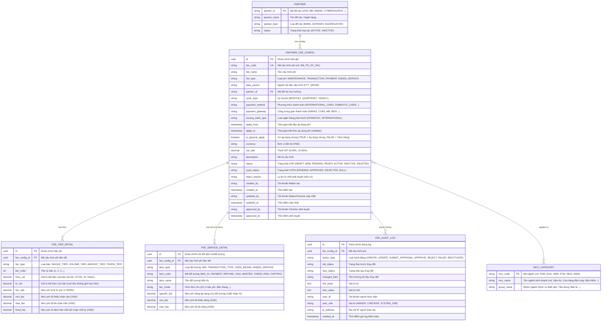

# Quản lý Cấu hình Phí Trả Đối tác — Entity Relationship Diagram (ERD)

> Scope: Phân hệ Quản lý Cấu hình Phí Trả Đối tác (partner-fee-management) trên EPAY Portal 2.0.

## 1. Diagram (Mermaid ERD)

---

## 2. Entity Reference (Từ điển dữ liệu chi tiết)

| Thực thể (Entity) | Mục đích nghiệp vụ | Khóa chính / Khóa ngoại | Các thuộc tính cốt lõi |
|---|---|---|---|
| **`PARTNER_FEE_CONFIG`** | Lưu trữ thông tin tổng thể của một cấu hình biểu phí trả cho đối tác; quản trị vòng đời qua 7 trạng thái bản ghi và trạng thái YCPD. | PK: `id` FK: `partner_id` | `fee_code`, `fee_name`, `fee_type`, `partner_id`, `status`, `ycpd_status`, `apply_from`, `apply_to`, `is_general_apply`, `vat_rate`. |
| **`FEE_TIER_DETAIL`** | Lưu trữ các mức phí chi tiết theo mô hình 1 bậc phí hoặc nhiều bậc phí bậc thang (theo Tổng SLGD, Tổng GTGD hoặc Tổng số lượng Token). | PK: `id` FK: `fee_config_id` | `tier_order`, `from_val`, `to_val`, `fee_rate`, `min_fee`, `max_fee`, `fixed_fee`. |
| **`FEE_SERVICE_DETAIL`** | Lưu trữ thông số phân rã khi chọn chế độ "Không áp dụng" (tách riêng từng MID, từng loại giao dịch Thanh toán/Hoàn trả, từng thương hiệu thẻ Visa/Master/JCB, hoặc từng dịch vụ gia tăng). | PK: `id` FK: `fee_config_id` | `item_type`, `item_code`, `item_name`, `fee_mode`, `specific_fee`, `min_fee`, `max_fee`. |
| **`FEE_AUDIT_LOG`** | Lưu vết toàn bộ lịch sử biến động dữ liệu và trạng thái cấu hình (bất biến - Immutable), phục vụ kiểm toán nội bộ, đối soát và giải trình thanh tra. | PK: `id` FK: `fee_config_id` | `action_type`, `old_status`, `new_status`, `changed_field`, `old_value`, `new_value`, `user_id`, `created_at`. |
| **`PARTNER`** | Quản lý danh mục các đối tác thụ hưởng, ngân hàng kết nối cổng thanh toán. | PK: `partner_id` | `partner_name`, `partner_type`, `status`. |
| **`MCC_CATEGORY`** | Danh mục mã ngành kinh doanh chuẩn quốc tế phục vụ phân loại đơn vị chấp nhận thanh toán khi cấu hình phí xử lý giao dịch. | PK: `mcc_code` | `mcc_name`, `group_name`. |

---

## 3. Notes & Assumptions

1. **Tính bất biến của Audit Log**: Bảng `FEE_AUDIT_LOG` chỉ cho phép thao tác `INSERT`, tuyệt đối cấm mọi thao tác `UPDATE` và `DELETE` ở tầng CSDL để đảm bảo tính pháp lý kiểm toán.
2. **Khóa logic chống xung đột**: CSDL áp dụng Unique Index có điều kiện trên bộ trường `(partner_id, payment_method, payment_gateway, fee_type)` đối với các bản ghi có trạng thái `ACTIVE` hoặc `READY` trong cùng khoảng thời gian chồng lấn `[apply_from, apply_to]`.
3. **Lưu trữ số tiền và tỷ lệ**: Mọi trường tiền tệ lưu dưới dạng `DECIMAL(15, 2)` (VND); mọi tỷ lệ phần trăm lưu dưới dạng `DECIMAL(7, 4)` (hỗ trợ độ chính xác đến 4 chữ số sau dấu phẩy).
