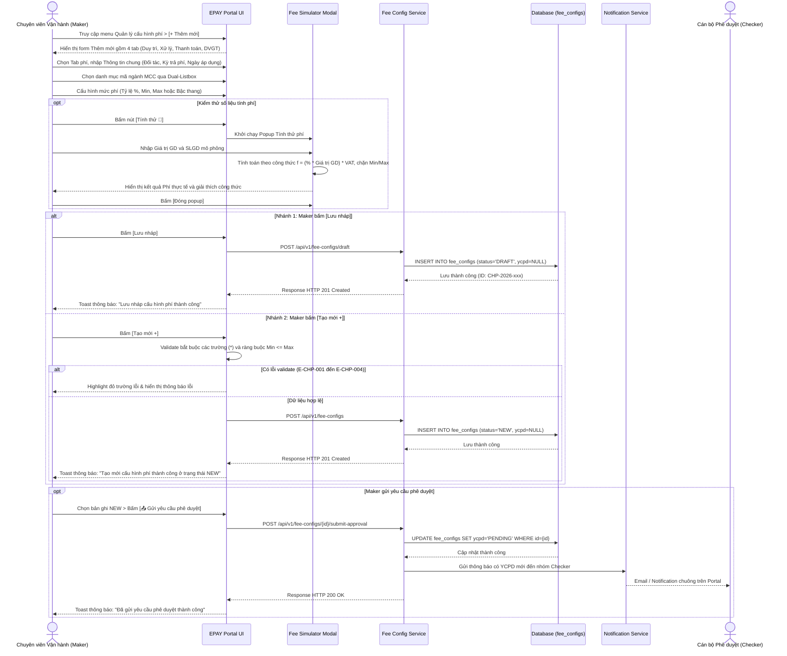
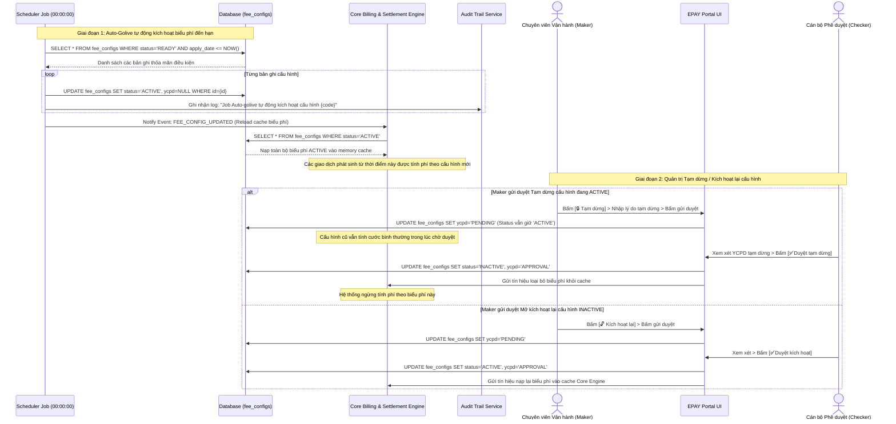

# Quản lý Cấu hình Phí Trả Đối tác — Flows

## Flow: Maker Tạo mới & Gửi yêu cầu phê duyệt cấu hình phí
**Trigger**: Maker bấm [+ Thêm mới] tại màn hình Quản lý cấu hình phí trên EPAY Portal.
**Related UC**: [[../usecases/uc-process-fee-profile.md]]
**Related FR**: FR-partner-fee-management-003, FR-partner-fee-management-004, FR-partner-fee-management-005, FR-partner-fee-management-006, FR-partner-fee-management-008
**Related E**: E-partner-fee-management-001, E-partner-fee-management-002, E-partner-fee-management-003, E-partner-fee-management-004



## Flow: Checker Thẩm định & Xử lý Yêu cầu Phê duyệt
**Trigger**: Checker mở tab "Chờ phê duyệt" hoặc bấm vào thông báo YCPD trên Portal.
**Related UC**: [[../usecases/uc-process-fee-profile.md]]
**Related FR**: FR-partner-fee-management-012
**Related E**: E-partner-fee-management-005, E-partner-fee-management-006

```mermaid
sequenceDiagram
    actor Checker as Cán bộ Phê duyệt (Checker)
    participant UI as EPAY Portal UI
    participant API as Fee Config Service
    participant DB as Database (fee_configs)
    participant Audit as Audit Trail Service
    participant Noti as Notification Service
    actor Maker as Chuyên viên Vận hành (Maker)

    Checker->>UI: Mở tab "Chờ phê duyệt" > Chọn mã cấu hình phí cần duyệt
    UI->>API: GET /api/v1/fee-configs/{id}/approval-detail
    API->>DB: Truy vấn thông tin cấu hình & lịch sử so sánh CŨ - MỚI
    DB-->>API: Trả về dataset chi tiết
    API-->>UI: Render màn hình Chi tiết Checker (Panel YCPD + Nút [✅ Phê duyệt] / [❌ Từ chối])

    Checker->>UI: Thẩm định đối tác, dịch vụ, MCC, mức phí và ngày áp dụng

    alt Nhánh 1: Checker chấp thuận [✅ Phê duyệt]
        Checker->>UI: Bấm [✅ Phê duyệt]
        UI->>UI: Hiển thị popup xác nhận phê duyệt
        Checker->>UI: Xác nhận Đồng ý
        UI->>API: POST /api/v1/fee-configs/{id}/approve
        API->>API: Kiểm tra Thời gian áp dụng phí so với thời điểm hiện tại (NOW)
        alt Ngày áp dụng phí > NOW (Áp dụng trong tương lai)
            API->>DB: UPDATE fee_configs SET status='READY', ycpd='APPROVAL' WHERE id={id}
            API->>Audit: Ghi log: "Checker duyệt cấu hình; chuyển trạng thái READY"
        else Ngày áp dụng phí <= NOW (Áp dụng ngay)
            API->>DB: UPDATE fee_configs SET status='ACTIVE', ycpd='APPROVAL' WHERE id={id}
            API->>Audit: Ghi log: "Checker duyệt cấu hình; chuyển trạng thái ACTIVE"
        end
        DB-->>API: Ghi nhận thành công
        API->>Noti: Bắn thông báo phê duyệt thành công tới Maker
        Noti-->>Maker: Nhận thông báo cấu hình đã được duyệt
        API-->>UI: Response HTTP 200 OK
        UI-->>Checker: Toast thông báo: "Phê duyệt cấu hình phí thành công"
    else Nhánh 2: Checker bác bỏ [❌ Từ chối]
        Checker->>UI: Bấm [❌ Từ chối]
        UI-->>Checker: Bật popup yêu cầu nhập Lý do từ chối (bắt buộc)
        Checker->>UI: Nhập lý do từ chối (vd: "Tỷ lệ phí sai lệch so với Hợp đồng đính kèm")
        UI->>API: POST /api/v1/fee-configs/{id}/reject (kèm reject_reason)
        API->>DB: UPDATE fee_configs SET status='NEW', ycpd='REJECTED', reject_reason={reason}
        API->>Audit: Ghi log: "Checker từ chối duyệt cấu hình; Lý do: {reason}"
        DB-->>API: Ghi nhận thành công
        API->>Noti: Gửi thông báo kèm lý do từ chối về hòm thư Maker
        Noti-->>Maker: Nhận thông báo bị từ chối kèm lý do để chỉnh sửa lại
        API-->>UI: Response HTTP 200 OK
        UI-->>Checker: Toast thông báo: "Đã từ chối yêu cầu phê duyệt cấu hình"
    end
```

## Flow: Scheduler Job Tự động Kích hoạt Cấu hình & Vận hành Core Billing
**Trigger**: Job lập lịch chạy định kỳ lúc 00:00:00 hằng ngày hoặc Maker gửi duyệt Tạm dừng/Kích hoạt lại.
**Related UC**: [[../usecases/uc-auto-golive.md]], [[../usecases/uc-process-fee-profile.md]]
**Related FR**: FR-partner-fee-management-013, FR-partner-fee-management-009, FR-partner-fee-management-010
**Related E**: E-partner-fee-management-007


