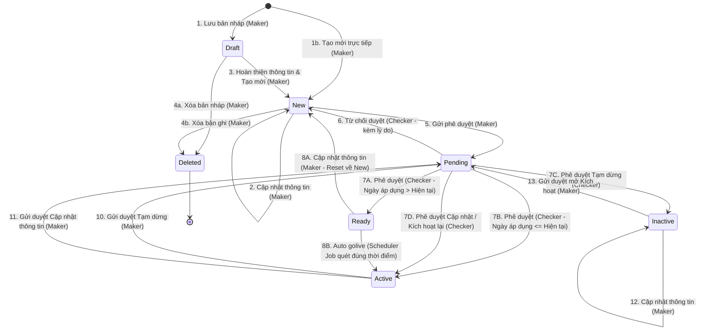

# Quản lý Cấu hình Phí Trả Đối tác — States

## State: PartnerFeeConfig
**Related entity**: PartnerFeeConfig
**Related UC**: [[../usecases/uc-process-fee-profile.md]], [[../usecases/uc-auto-golive.md]], [[../usecases/uc-delete-fee.md]], [[../usecases/uc-view-detail-fee.md]]
**Related BR**: BR-partner-fee-management-001, BR-partner-fee-management-002, BR-partner-fee-management-003

### Invalid transitions

| Từ trạng thái | Đến trạng thái | Lý do cấm (Why not) |
|---|---|---|
| `Deleted` | Bất kỳ | Bản ghi đã xóa vĩnh viễn khỏi chu trình vận hành, không được phép phục hồi |
| `Active` | `Deleted` | Cấu hình đang hoạt động tính cước không được phép xóa; bắt buộc phải qua luồng Tạm dừng (`Inactive`) |
| `Ready` | `Deleted` | Cấu hình đã được Checker phê duyệt sẵn sàng golive không được xóa trực tiếp; phải cập nhật để reset về `New` rồi mới xóa |
| `Inactive` | `Deleted` | Cấu hình đã từng phát sinh hiệu lực tính cước phải được bảo toàn trong cơ sở dữ liệu để phục vụ đối soát và kiểm toán lịch sử (Audit Log) |
| `Pending` | `Deleted` | Bản ghi đang trong hàng đợi phê duyệt của Checker bị khóa thao tác xóa để đảm bảo tính toàn vẹn của Yêu cầu phê duyệt (YCPD) |
| `Active` | `Ready` | Cấu hình đang có hiệu lực không thể quay ngược về trạng thái chờ kích hoạt trong tương lai |
| `Draft` | `Pending` | Bản nháp chưa được xác thực đầy đủ các trường thông tin bắt buộc (*); phải bấm [Tạo mới +] để chuyển sang `New` trước khi gửi duyệt |
| `Draft` | `Active` / `Ready` | Bắt buộc phải tuân thủ nguyên tắc kiểm soát 4 mắt (Maker – Checker), không thể nhảy cóc từ nháp lên trạng thái hiệu lực |
