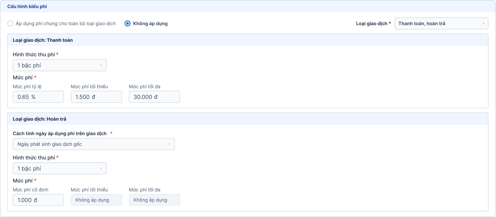
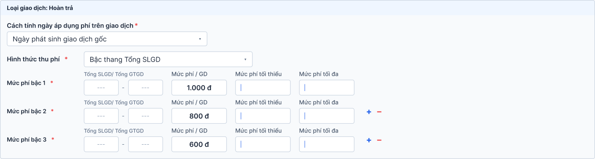
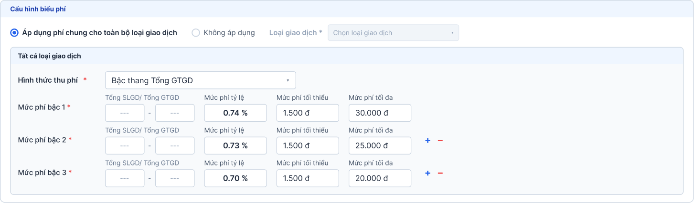

# Đồng bộ giao diện QRGW theo CTT — 27/11/2026

**Đích thiết kế:** Figma `ForWork` → `CHP Đối tác v2` → Section QRGW `4302:3265`. Bản đồ frame đang sử dụng và tọa độ thực tế được ghi trong [danh mục màn hình](srs/partner-fee-management-screens.md). Không thay đổi CTT gốc hay logic tính phí QRGW.

## 1. Các thay đổi giao diện

- Đồng bộ kích thước, khoảng cách trường tin, tiêu đề khối và cột thao tác theo thiết kế CTT. Sửa các lỗi bảng bị cắt cột thao tác, thông tin chung tràn khung và popup tính thử cắt nội dung.
- Vẽ lại bốn frame Thêm mới gốc, bổ sung ba biến thể trong đúng Section đang có; giữ nguyên ID frame gốc. Không dùng các frame Review đã xóa.
- Áp dụng chung bố cục một bậc cho Thanh toán, Hoàn trả, phí xử lý giao dịch và phí thanh toán trên toàn bộ màn có biểu phí một bậc: dropdown 220 px; tiêu đề Mức phí (*); ba ô 120 px, khoảng cách 16 px.
- Phí tỷ lệ giữ tỷ lệ, Min, Max vốn có. Phí cố định giữ giá trị cố định; Min/Max chỉ hiển thị Không áp dụng (không cho nhập, không tạo trường dữ liệu mới). Nhãn lựa chọn thống nhất `1 bậc phí`; không thay đổi cách tính phí và đơn vị của giá trị gốc.
- Bậc thang: nhãn hình thức thu phí ở trái, dropdown 320 px; từng hàng có nhãn bậc, hai ô khoảng giá trị, mức phí, Min/Max, nút `+` và `−` ở các bậc tương ứng. Giữ số lượng bậc và dữ liệu minh họa của QRGW.

## 2. Màn thêm mới hiện hành

| Section | Màn hình | Figma Frame ID | Thay đổi |
|---|---|---|---|
| 02 · XLGD (`4216:15623`) | Áp dụng chung – 1 bậc | `4116:18663` | Cập nhật |
| 02 · XLGD | Riêng từng loại GD – bậc thang | `4116:18825` | Cập nhật |
| 02 · XLGD | Riêng từng loại GD – 1 bậc | `4389:11325` | Biến thể mới |
| 03 · Thanh toán (`4216:15626`) | Áp dụng chung – 1 bậc | `4116:19078` | Cập nhật |
| 03 · Thanh toán | Áp dụng chung – bậc thang GTGD | `4390:11790` | Biến thể mới |
| 03 · Thanh toán | Riêng từng loại GD – 1 bậc | `4116:19262` | Cập nhật |
| 03 · Thanh toán | Riêng từng loại GD – bậc thang GTGD | `4390:12055` | Biến thể mới |

## 3. Kiểm tra bàn giao

Đã đọc lại cấu trúc 20 frame biểu phí (19 có phần một bậc, một frame chỉ có bậc thang) và xác nhận 34/34 khối một bậc cùng ba ô: 15 khối tỷ lệ, 19 khối cố định. Các trường hợp một bậc xuất hiện ở 6 màn thêm mới, 8 màn chi tiết/phê duyệt, 5 màn xử lý hồ sơ. Tất cả khối được chỉnh đã qua kiểm tra hình học; hai màn Checker kiểm tra riêng nền và drawer để phân biệt lớp phủ chủ ý. Cảnh báo accessibility của thiết kế cũ còn tồn tại và chưa có kiểm thử trên hệ thống chạy thật.

Không thêm quyền xử lý, thay đổi validation, công thức, dữ liệu lưu trữ, trạng thái CHP/YCPD hoặc luồng nghiệp vụ. Dữ liệu minh họa không phải biểu phí được phê duyệt. Các biến thể Figma là thiết kế giao diện, không phải chức năng chạy thực tế.

## 4. Ảnh kiểm chứng từ Figma

**Một bậc — Thanh toán và Hoàn trả (cùng layout)**

**Bậc thang Tổng SLGD**

**Bậc thang Tổng GTGD**

## 5. Quy tắc vẽ Figma

Quy tắc bắt buộc lưu tại [AGENTS.md](../../AGENTS.md): mỗi nhóm chức năng độc lập có Section riêng; các biến thể và popup liên quan nằm cùng Section; ưu tiên cập nhật Section hiện có, kiểm tra frame con và ảnh render trước bàn giao. Quy tắc này ở cấp dự án, không phải cài đặt toàn cục Reqwise.
